# DkWealth Admin Portal — Backend Server

> Back-office backend for **DK Wealth**, a mutual-fund distribution business.
> It combines a session-authenticated **CRM API** (users, leads, tasks), a **business analytics API**, and a set of
> **scheduled data-ingestion pipelines** that pull transaction and AUM (Assets Under Management) reports from the
> registrar agencies **CAMS** and **KFintech (Karvy)**, the **BSE StAR MF** scheme master and the **AMFI** industry AUM
> disclosures into a single PostgreSQL database.

| Item | Value |
|---|---|
| Runtime | Node.js (CommonJS) |
| Web framework | Express 5 |
| Database | PostgreSQL via Prisma 7 (`@prisma/adapter-pg`) |
| Scheduler | `node-cron` (all schedules in `Asia/Kolkata`) |
| Auth model | Cookie session (`express-session`), password hashing with `bcrypt` |
| Validation | Joi |
| Mail ingestion | IMAP (`imapflow`) + `mailparser` |
| Archive handling | 7-Zip CLI (password-protected ZIP reports) |
| Default port | `5000` (from `PORT`) |
| Code location | `server/` (the repository currently contains only the backend) |

---

## Table of Contents

1. [Overview](#1-overview)
   - [1.1 What the system does](#11-what-the-system-does)
   - [1.2 Who and what it talks to](#12-who-and-what-it-talks-to)
   - [1.3 Feature summary](#13-feature-summary)
   - [1.4 Domain glossary](#14-domain-glossary)
2. [System Architecture](#2-system-architecture)
   - [2.1 High-level architecture](#21-high-level-architecture)
   - [2.2 Layering and module conventions](#22-layering-and-module-conventions)
   - [2.3 Technology stack](#23-technology-stack)
3. [Repository and Directory Structure](#3-repository-and-directory-structure)
   - [3.1 Directory tree](#31-directory-tree)
   - [3.2 Folder-by-folder explanation](#32-folder-by-folder-explanation)
   - [3.3 File-by-file reference](#33-file-by-file-reference)
4. [Getting Started](#4-getting-started)
   - [4.1 Prerequisites](#41-prerequisites)
   - [4.2 Installing 7-Zip](#42-installing-7-zip)
   - [4.3 Installing packages](#43-installing-packages)
   - [4.4 Configuring the environment](#44-configuring-the-environment)
   - [4.5 Database setup, migrations and seeding](#45-database-setup-migrations-and-seeding)
   - [4.6 Running the server](#46-running-the-server)
   - [4.7 First-run checklist](#47-first-run-checklist)
5. [Configuration Reference](#5-configuration-reference)
   - [5.1 Environment variables](#51-environment-variables)
   - [5.2 Example `.env`](#52-example-env)
   - [5.3 Settings that live in code](#53-settings-that-live-in-code)
6. [Application Bootstrap and Request Pipeline](#6-application-bootstrap-and-request-pipeline)
7. [Data Model](#7-data-model)
   - [7.1 Entity-relationship overview](#71-entity-relationship-overview)
   - [7.2 CRM models](#72-crm-models)
   - [7.3 CAMS transaction models](#73-cams-transaction-models)
   - [7.4 Karvy transaction models](#74-karvy-transaction-models)
   - [7.5 AUM models](#75-aum-models)
   - [7.6 BSE scheme master](#76-bse-scheme-master)
   - [7.7 Migrations history](#77-migrations-history)
   - [7.8 AUM category seed](#78-aum-category-seed)
8. [API Reference](#8-api-reference)
   - [8.1 Conventions](#81-conventions)
   - [8.2 Health](#82-health)
   - [8.3 Authentication and Users](#83-authentication-and-users)
   - [8.4 Leads](#84-leads)
   - [8.5 Tasks](#85-tasks)
   - [8.6 Company AUM import](#86-company-aum-import)
   - [8.7 Analytics](#87-analytics)
   - [8.8 Endpoint summary table](#88-endpoint-summary-table)
9. [Scheduled Jobs and Ingestion Pipelines](#9-scheduled-jobs-and-ingestion-pipelines)
   - [9.1 Job registry and daily timeline](#91-job-registry-and-daily-timeline)
   - [9.2 Shared building blocks](#92-shared-building-blocks)
   - [9.3 CAMS transactions pipeline](#93-cams-transactions-pipeline)
   - [9.4 CAMS AUM (WBR22) pipeline](#94-cams-aum-wbr22-pipeline)
   - [9.5 Karvy transactions pipeline](#95-karvy-transactions-pipeline)
   - [9.6 Karvy AUM pipeline](#96-karvy-aum-pipeline)
   - [9.7 BSE StAR scheme master job](#97-bse-star-scheme-master-job)
   - [9.8 AMFI industry AUM job](#98-amfi-industry-aum-job)
   - [9.9 Date-label job](#99-date-label-job)
   - [9.10 How company AUM is calculated](#910-how-company-aum-is-calculated)
   - [9.11 Fund-name to category matching](#911-fund-name-to-category-matching)
10. [Logging and Observability](#10-logging-and-observability)
11. [Manual Runs and Testing](#11-manual-runs-and-testing)
12. [Security Notes](#12-security-notes)
13. [Troubleshooting and FAQ](#13-troubleshooting-and-faq)
14. [Known Limitations and Recommended Follow-ups](#14-known-limitations-and-recommended-follow-ups)
15. [Deployment Checklist](#15-deployment-checklist)
16. [Appendix](#16-appendix)

---

## 1. Overview

### 1.1 What the system does

DK Wealth distributes mutual funds. Day to day, the business needs to answer three kinds of question:

1. **Who are we dealing with and what do we have to do next?** — leads, follow-ups and tasks handled by the admin team.
2. **What did our clients transact?** — every purchase, redemption, switch and SIP instalment reported by the two mutual-fund
   registrars (RTAs), CAMS and KFintech (formerly Karvy).
3. **How much money do we manage, and how do we compare with the industry?** — the company's AUM per fund, AMC and category
   versus the industry-wide AMFI disclosures.

This server is the single backend that answers all three. It exposes a REST API for the admin UI and, in the same process,
runs cron jobs that read report e-mails from a Gmail inbox, download and unlock the password-protected ZIP attachments,
parse the CSVs and store everything in PostgreSQL.

> **Important:** the API server and the cron jobs run **in the same Node.js process**. `index.js` simply `require`s each job
> file, which registers its schedule. There is no separate worker process.

### 1.2 Who and what it talks to

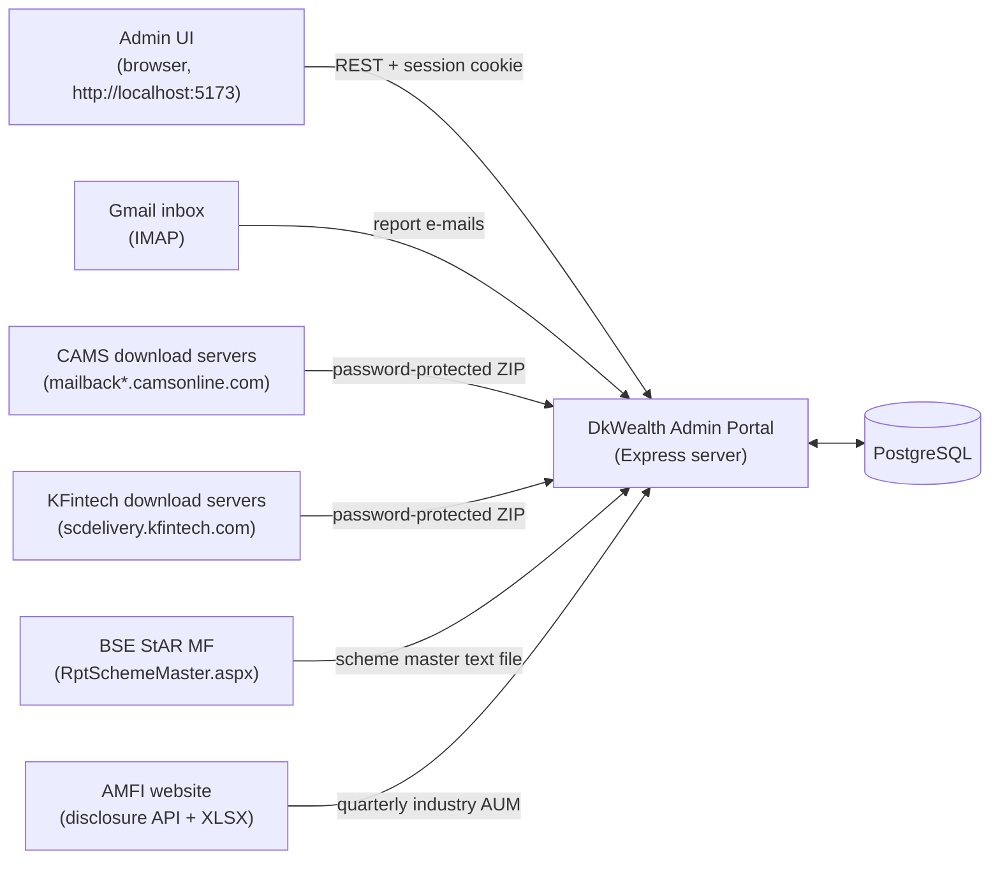

| External system | Used for | Direction | Authentication |
|---|---|---|---|
| Gmail (IMAP) | Receive CAMS / KFintech report e-mails | Pull | App password (`GMAIL_IMAP_*`) |
| CAMS mail-back servers | Download report ZIP | Pull (HTTP) | Signed link in the e-mail, ZIP password |
| KFintech `scdelivery` | Download report ZIP | Pull (HTTP) | Tracking link in the e-mail, ZIP password |
| BSE StAR MF | Daily scheme master (scheme → category / AMC) | Pull (HTTP, page scrape) | None (public page) |
| AMFI | Quarterly industry AUM / AAUM by category | Pull (HTTP + XLSX) | None (public) |
| PostgreSQL | All persistent data | Read / write | `DATABASE_URL` |

### 1.3 Feature summary

| Area | Capability | Where |
|---|---|---|
| Authentication | Sign-up, login, logout, session check, user lookup | `routes/authentication.js` |
| Leads | CRUD with document upload; owner-scoped | `routes/leads.js` |
| Tasks | CRUD; owner-scoped | `routes/tasks.js` |
| Company AUM import | Manual upload of WBR22 files for a quarter | `routes/companyAum.js` |
| Analytics | AUM / AAUM by AMC and by category (latest quarter with data) | `routes/analytics.js` |
| CAMS transactions | Daily e-mail → ZIP → CSV → DB | `jobs/camsIngestionJob.js` |
| CAMS AUM | Daily WBR22 e-mail → company AUM per fund | `jobs/wbr22AumIngestionJob.js` |
| Karvy transactions | Daily e-mail → ZIP → CSV → DB | `jobs/karvyTransactionIngestionJob.js` |
| Karvy AUM | Daily "ClientWise AUM" e-mail → company AUM per fund | `jobs/karvyWbr22AumIngestionJob.js` |
| BSE scheme master | Daily refresh of ~all scheme → category / AMC mappings | `jobs/bseStarSchemeMasterIngestionJob.js` |
| AMFI industry AUM | Monthly check for newly published quarters | `jobs/amfiIngestionJob.js` |
| Date labels | Daily refresh of "Today / Tomorrow / Expired" labels | `jobs/dateStatusJob.js` |

### 1.4 Domain glossary

| Term | Meaning |
|---|---|
| **AUM** | Assets Under Management — the market value of client holdings at a point in time. |
| **AAUM** | Average AUM — the average of AUM over a period. For company data in this system it is a running average of daily totals within a quarter (see [9.10](#910-how-company-aum-is-calculated)). |
| **RTA** | Registrar and Transfer Agent. The two in India's mutual-fund industry are **CAMS** and **KFintech** (Karvy). |
| **CAMS** | Computer Age Management Services. Sends "Investor Transactions for a Period" and "WBR22" reports. |
| **KFintech / Karvy** | KFin Technologies, formerly Karvy. In code and tables the older name "Karvy" is used. Sends "Transaction Feeds Report" and "ClientWise AUM Report". |
| **WBR22** | CAMS report "AuM on a specific date by Scheme by Investor" — one row per client per scheme. KFintech's equivalent is the ClientWise AUM Report; this codebase calls both "WBR22". |
| **WBR2 / transactions report** | CAMS "Investor Transactions for a Period" CSV (about 80 columns). |
| **Transaction Feeds Report** | KFintech's transactions CSV (about 90 columns). |
| **AMC** | Asset Management Company (the fund house, e.g. HDFC Mutual Fund). |
| **AMFI** | Association of Mutual Funds in India; publishes quarterly AUM/AAUM disclosure by category. |
| **BSE StAR MF** | BSE's mutual-fund order platform; its scheme master lists every scheme with type (category) and AMC code. |
| **Scheme type** | The broad category in the BSE master (e.g. `EQUITY`, `DEBT`, `LIQUID`). Used as the company's category. |
| **Folio** | An investor's account with an AMC. |
| **ARN** | AMFI Registration Number of the distributor. |
| **Financial year (FY)** | 1 April – 31 March, written like `2025-26`. Q1 = Apr–Jun, Q2 = Jul–Sep, Q3 = Oct–Dec, Q4 = Jan–Mar. |
| **Fingerprint** | SHA-256 hash used for idempotency (per report and per transaction). |
| **Idempotent** | Re-running a job never duplicates data. |

---

## 2. System Architecture

### 2.1 High-level architecture

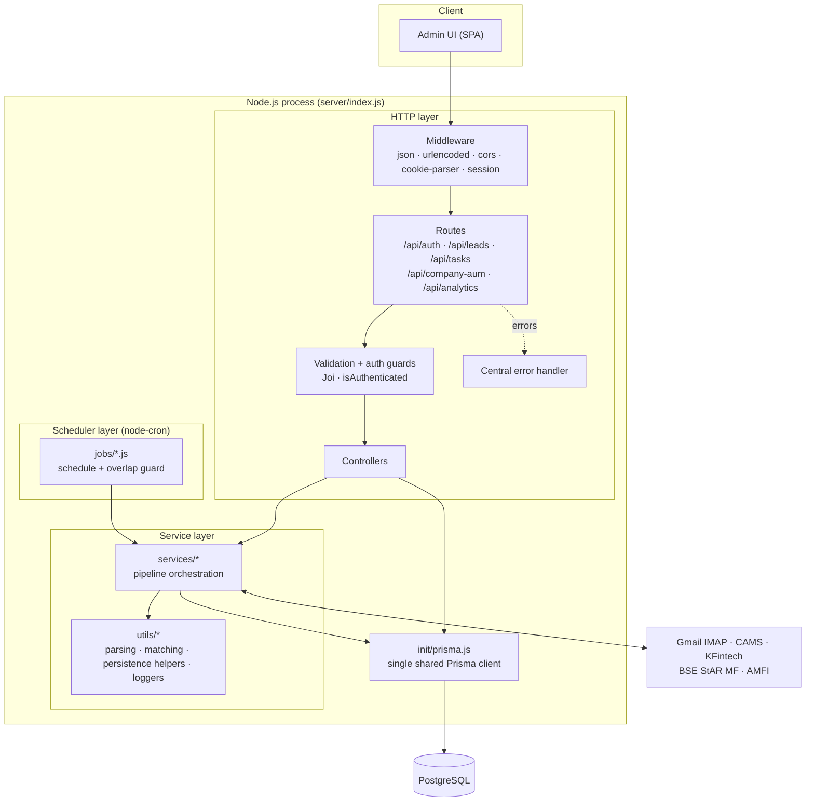

**Reading the diagram**

- A browser request flows left to right through middleware, a route, validation/auth guards and a controller. Controllers
  talk to PostgreSQL directly through Prisma, except for the company-AUM import which delegates to a service.
- A cron tick flows through a job file (schedule + "already running?" guard) into a service (the pipeline conductor), which
  uses utils for the detailed work and Prisma for persistence.
- There is exactly **one** Prisma client (`init/prisma.js`) and therefore one connection pool for HTTP and jobs alike.

### 2.2 Layering and module conventions

| Layer | Folder | Responsibility | Must not |
|---|---|---|---|
| Entry | `index.js` | Wire middleware, routers, jobs; start listening | Contain business logic |
| Routes | `routes/` | Map URL + verb to guards and a controller | Query the database |
| Middleware | `middlewares/` | Joi validation wrappers, `isAuthenticated` | Mutate business data |
| Controllers | `controllers/` | Read the request, call Prisma/services, shape the response | Contain parsing or scheduling code |
| Jobs | `jobs/` | Own the cron expression and the "already running" flag | Contain pipeline logic |
| Services | `services/<pipeline>/` | Orchestrate one pipeline stage or the whole pipeline | Contain regex/CSV minutiae |
| Utils | `utils/` | Pure-ish helpers: parsing, matching, fingerprinting, logging | Own schedules |
| Data | `prisma/` + `init/` | Schema, migrations, seeds, shared client | — |

**Naming conventions**

- Pipeline code is grouped by source: `cams_transactions`, `cams_wbr22` (company AUM persistence shared by CAMS and Karvy),
  `cams_wbr22_automation`, `karvy_transactions`, `karvy_wbr22_automation`, `karvy_shared`, `industry_aum`, `bse_star_master`.
- Each *transaction* pipeline follows the same five-stage shape: **email → report (download + extract) → csv → database →
  summary/log**. The two AUM pipelines follow: **email → report → build file → BSE preflight → company AUM persistence**.
- Every pipeline stage returns a *structured result* instead of throwing for expected failures, so one bad report never stops
  the others in the same run.
- Errors that should become HTTP responses are thrown as `new customError(status, message)`; async handlers are wrapped in
  `wrapAsync` so rejections reach the central error handler.

### 2.3 Technology stack

| Concern | Library | Version (package.json) | Notes |
|---|---|---|---|
| HTTP | `express` | ^5.2.1 | Express 5 forwards sync throws and rejected promises to the error handler |
| ORM | `prisma`, `@prisma/client` | ^7.9.1 | Prisma 7 with a driver adapter |
| Postgres driver | `pg`, `@prisma/adapter-pg` | ^8.23.0 / ^7.9.1 | Connection string from `DATABASE_URL` |
| Sessions | `express-session` | ^1.19.0 | Default in-memory store (see [12](#12-security-notes)) |
| Session store (installed) | `connect-pg-simple` | ^10.0.0 | Installed but **not wired in** |
| Cookies | `cookie-parser` | ^1.4.7 | Signed with `SECRET` |
| CORS | `cors` | ^2.8.6 | Origin allow-list `http://localhost:5173` |
| Passwords | `bcrypt` | ^6.0.0 | Cost factor 12 |
| Validation | `joi` | ^18.2.3 | Body (and query, for analytics) |
| Uploads | `multer` | ^2.2.0 | Disk storage for leads, memory storage for company AUM |
| Scheduling | `node-cron` | ^4.6.0 | All jobs use `Asia/Kolkata` |
| IMAP | `imapflow` | ^1.7.2 | Fresh client per run |
| MIME | `mailparser` | ^3.9.15 | Parses e-mail source |
| CSV | `csv-parse` | ^6.2.1 | Streaming (CAMS) and sync (Karvy) |
| Excel | `xlsx` | ^0.18.5 | AMFI quarterly workbook |
| Env | `dotenv` | ^17.4.2 | Loaded at start-up and by several services |
| Google libs | `googleapis`, `@google-cloud/local-auth` | ^176.0.0 / ^3.0.1 | Installed; not used by the current runtime code |
| External binary | **7-Zip** | n/a | Required for extracting protected ZIPs |

---

## 3. Repository and Directory Structure

### 3.1 Directory tree

```text
DkWealth-AdminPortal/
├── README.md                         ← this document
├── .gitignore
└── server/
    ├── index.js                      ← application entry point
    ├── package.json / package-lock.json
    ├── prisma.config.ts              ← Prisma 7 config (schema path, migrations path, datasource URL)
    ├── skills-lock.json              ← tooling lock file for AI-assistant skills (not used at runtime)
    ├── example_response.json         ← sample parsed e-mail output (git-ignored)
    ├── cams-reports.json             ← audit dump written by the CAMS e-mail service (git-ignored)
    │
    ├── init/
    │   └── prisma.js                 ← the one shared Prisma client
    │
    ├── middlewares/
    │   └── middleware.js             ← Joi validators + isAuthenticated guard
    │
    ├── routes/
    │   ├── authentication.js         ← /api/auth/*
    │   ├── leads.js                  ← /api/leads/*
    │   ├── tasks.js                  ← /api/tasks/*
    │   ├── companyAum.js             ← /api/company-aum/*
    │   └── analytics.js              ← /api/analytics/* and /analytics/*
    │
    ├── controllers/
    │   ├── authentication.js
    │   ├── leads.js
    │   ├── tasks.js
    │   ├── companyAum.js
    │   └── analytics.js
    │
    ├── jobs/                         ← cron schedules + overlap guards
    │   ├── camsIngestionJob.js
    │   ├── karvyTransactionIngestionJob.js
    │   ├── wbr22AumIngestionJob.js
    │   ├── karvyWbr22AumIngestionJob.js
    │   ├── bseStarSchemeMasterIngestionJob.js
    │   ├── amfiIngestionJob.js
    │   └── dateStatusJob.js
    │
    ├── services/                     ← pipeline orchestration
    │   ├── cams_transactions/
    │   │   ├── camsIngestionService.js
    │   │   ├── emailService.js
    │   │   ├── csvService.js
    │   │   └── camsDatabaseService.js
    │   ├── cams_wbr22_automation/
    │   │   ├── wbr22AumIngestionService.js
    │   │   ├── wbr22EmailService.js
    │   │   └── reportService.js      ← shared ZIP download + extract (used by ALL four e-mail pipelines)
    │   ├── cams_wbr22/
    │   │   └── companyAumIngestionService.js   ← shared company-AUM persistence (API + CAMS cron)
    │   ├── karvy_transactions/
    │   │   ├── karvyIngestionService.js
    │   │   ├── emailService.js
    │   │   ├── csvService.js
    │   │   └── karvyDatabaseService.js
    │   ├── karvy_wbr22_automation/
    │   │   ├── karvyWbr22AumIngestionService.js
    │   │   ├── karvyWbr22EmailService.js
    │   │   └── karvyCompanyAumIngestionService.js
    │   ├── bse_star_master/
    │   │   └── bseStarSchemeMasterIngestionService.js
    │   └── industry_aum/
    │       ├── amfiIngestionService.js
    │       └── industryAumService.js
    │
    ├── utils/
    │   ├── customError.js · wrapAsync.js · date_processor.js
    │   ├── ValidateSignup.js · ValidateLogin.js · ValidateLead.js · ValidateTask.js · ValidateAnalytics.js
    │   ├── cams_transactions/        ← CSV parser, fingerprints, report persistence helpers, logger, summary
    │   ├── cams_wbr22/               ← WBR22 parser, scheme matcher, master list, upsert, BSE login helper
    │   ├── cams_wbr22_automation/    ← IMAP client, e-mail field extraction, ZIP/7-Zip handling, cron-file builder, logger
    │   ├── karvy_shared/             ← KFintech e-mail parsing (ref numbers, obfuscated download links)
    │   ├── karvy_transactions/       ← Karvy CSV parser, fingerprints, persistence helpers, logger, summary
    │   ├── karvy_wbr22_automation/   ← Karvy AUM CSV parser, logger
    │   ├── industry_aum/             ← AMFI API, XLSX parser, period math, category resolver, import tracker, logger
    │   ├── bse_star_master/          ← BSE scraper + pipe-delimited parser
    │   └── logs/                     ← log files of the CAMS, WBR22 and AMFI loggers (git-ignored)
    │
    ├── prisma/
    │   ├── schema.prisma
    │   ├── migrations/               ← 13 SQL migrations + migration_lock.toml
    │   └── seed/
    │       ├── aumCategoryData.js    ← AMFI category hierarchy as data
    │       └── seedAumCategories.js  ← idempotent seeder
    │
    ├── logs/                         ← log files of the two Karvy loggers (git-ignored)
    ├── uploads/                      ← lead documents (created by multer on first upload; not tracked)
    ├── temp/                         ← manual runners and scratch files (git-ignored)
    └── .agents/                      ← AI-assistant skill files (git-ignored, not part of the product)
```

> `temp/`, `logs/`, `uploads/`, `.agents/`, `cams-reports.json` and `example_response.json` are git-ignored. They may exist
> on a developer machine but are not part of the deliverable.

### 3.2 Folder-by-folder explanation

| Folder | Purpose | Typical reader question it answers |
|---|---|---|
| `init/` | Creates the shared Prisma client | "Where is the DB connection created?" |
| `middlewares/` | Reusable Express middleware | "Where is request validation / login checking done?" |
| `routes/` | URL → handler wiring | "Which URL calls which controller?" |
| `controllers/` | HTTP request handlers | "What does endpoint X actually do?" |
| `jobs/` | Cron registration | "When does job Y run and can it overlap itself?" |
| `services/` | Pipeline conductors | "In what order does pipeline Z run its stages?" |
| `utils/` | Helpers | "How are CSVs / e-mails / names parsed?" |
| `prisma/` | Schema, migrations, seeds | "What tables exist and how do I create them?" |
| `logs/`, `utils/logs/` | Structured JSON job logs | "Did last night's job succeed?" |
| `temp/` | Manual test runners | "How do I run a pipeline once, right now?" |

### 3.3 File-by-file reference

#### Entry and configuration

| File | What it contains |
|---|---|
| `index.js` | Builds the Express app. Loads `.env`, `require`s all seven job files (registering their cron schedules), adds body parsers, CORS, cookie-parser and sessions, mounts the five routers, adds the central error handler and starts listening on `PORT`. |
| `package.json` | Dependencies. Note: there is **no** `start` script; the app is started with `node index.js`. |
| `prisma.config.ts` | Prisma 7 configuration: schema at `prisma/schema.prisma`, migrations at `prisma/migrations`, datasource URL from `DATABASE_URL`. |
| `init/prisma.js` | Creates `PrismaPg` adapter from `DATABASE_URL` and exports a single `prisma` client. |

#### Middleware

| File | Exports |
|---|---|
| `middlewares/middleware.js` | `SignupValidate`, `LoginValidate`, `TaskValidate`, `LeadValidate`, `AnalyticsValidate` (each runs a Joi schema and throws `customError(400, firstMessage)` on failure) and `isAuthenticated` (returns `401 {message:"Authentication required"}` unless `req.session.session_id` is set). |

#### Routes

| File | Mount path | Endpoints |
|---|---|---|
| `routes/authentication.js` | `/api/auth` | `POST /signup`, `POST /login`, `GET /getUsers`, `GET /getUser/:id`, `GET /logout`, `GET /isAuthenticated` |
| `routes/leads.js` | `/api/leads` | `POST /create`, `PATCH /update`, `GET /getLeads`, `GET /lead/:leadId`, `DELETE /delete/:leadId` |
| `routes/tasks.js` | `/api/tasks` | `POST /create`, `PATCH /update`, `GET /getTasks`, `GET /task/:taskId`, `DELETE /delete/:taskId` |
| `routes/companyAum.js` | `/api/company-aum` | `POST /import` |
| `routes/analytics.js` | `/api/analytics` and `/analytics` | `GET`/`POST` `/performance_amc`, `/performance_category`, `/performance_catagory` |

#### Controllers

| File | Functions |
|---|---|
| `controllers/authentication.js` | `signup`, `login`, `getUsers`, `getSingleUser`, `logout`, `isAuthenticatedController` |
| `controllers/leads.js` | `create`, `update`, `getAll`, `getSingle`, `remove` |
| `controllers/tasks.js` | `create`, `update`, `getAll`, `getSingle`, `remove` |
| `controllers/companyAum.js` | `importCompanyAum` (validates input, calls `ingestCompanyAumFiles`) |
| `controllers/analytics.js` | `getPerformanceAmc`, `getPerformanceCategory`, plus the internal `getLatestAvailableAumPeriod` |

#### Jobs

| File | Exports | Schedule (IST) |
|---|---|---|
| `jobs/bseStarSchemeMasterIngestionJob.js` | `runBseStarSchemeMasterIngestion` | `0 1 * * *` — daily 01:00 |
| `jobs/camsIngestionJob.js` | `runCamsIngestion` | `0 8 * * *` — daily 08:00 |
| `jobs/dateStatusJob.js` | *(none — registers on load)* | `0 8 * * *` — daily 08:00 |
| `jobs/karvyTransactionIngestionJob.js` | `runKarvyTransactionIngestion` | `30 8 * * *` — daily 08:30 |
| `jobs/wbr22AumIngestionJob.js` | `runWbr22AumIngestion` | `30 11 * * *` — daily 11:30 |
| `jobs/karvyWbr22AumIngestionJob.js` | `runKarvyWbr22AumIngestion` | `0 12 * * *` — daily 12:00 |
| `jobs/amfiIngestionJob.js` | `runAmfiIngestion` | `0 8 1 * *` — 08:00 on the 1st of every month |

#### Services

| File | Role |
|---|---|
| `services/cams_transactions/camsIngestionService.js` | Orchestrator: e-mail → ZIP → CSV → DB → summary + log. |
| `services/cams_transactions/emailService.js` | Reads Gmail, keeps "Investor Transactions for a Period" mails whose request number is on the allow-list, writes `cams-reports.json`. |
| `services/cams_transactions/csvService.js` | Parses each extracted CSV into transaction records; never throws for a single bad report. |
| `services/cams_transactions/camsDatabaseService.js` | Idempotent persistence of one report and its transactions in a single DB transaction. |
| `services/cams_wbr22_automation/reportService.js` | Shared: validates URL, downloads ZIP, extracts with 7-Zip, finds the CSV. Used by the CAMS and Karvy pipelines alike. |
| `services/cams_wbr22_automation/wbr22EmailService.js` | Reads WBR22 e-mails (default 14-day look-back). |
| `services/cams_wbr22_automation/wbr22AumIngestionService.js` | Orchestrator for CAMS AUM. |
| `services/cams_wbr22/companyAumIngestionService.js` | Shared company-AUM persistence: parse, match to category/AMC, upsert, track file imports. Used by the manual API and by the CAMS cron. |
| `services/karvy_transactions/karvyIngestionService.js` | Orchestrator for Karvy transactions. |
| `services/karvy_transactions/emailService.js` | Reads "Transaction Feeds Report" mails (24-hour look-back, allow-list). |
| `services/karvy_transactions/csvService.js` | Karvy CSV → records. |
| `services/karvy_transactions/karvyDatabaseService.js` | Idempotent persistence into the Karvy tables. |
| `services/karvy_wbr22_automation/karvyWbr22AumIngestionService.js` | Orchestrator for Karvy AUM (24-hour look-back). |
| `services/karvy_wbr22_automation/karvyWbr22EmailService.js` | Reads "ClientWise AUM Report" mails. |
| `services/karvy_wbr22_automation/karvyCompanyAumIngestionService.js` | Karvy variant of company-AUM persistence (differs only in the parser). |
| `services/bse_star_master/bseStarSchemeMasterIngestionService.js` | Downloads, parses and fully replaces the `bse_scheme_masters` table. |
| `services/industry_aum/amfiIngestionService.js` | Walks every financial year/quarter AMFI has published and imports the missing ones. |
| `services/industry_aum/industryAumService.js` | Rebuilds the category hierarchy for a quarter and stores `IndustryAum` rows in one transaction. |

#### Utilities (top level)

| File | Purpose |
|---|---|
| `utils/customError.js` | `customError(status, message)` — an `Error` carrying an HTTP status. |
| `utils/wrapAsync.js` | Forwards a rejected async handler to `next(err)`. |
| `utils/date_processor.js` | `getDateLabel(date)` → `Expired` / `Today` / `Tomorrow` / `DD Mon`. |
| `utils/ValidateSignup.js`, `ValidateLogin.js`, `ValidateLead.js`, `ValidateTask.js`, `ValidateAnalytics.js` | Joi schemas (see [8](#8-api-reference)). |

#### Utilities (by pipeline)

| File | Purpose |
|---|---|
| `utils/cams_wbr22_automation/camsEmailParsingUtils.js` | `createImapClient()` and all regex/MIME helpers: download URL (restricted to `mailbackN.camsonline.com`), request/report numbers, date range, dispatch time, ARN. Used by CAMS **and** Karvy e-mail services for the shared fields. |
| `utils/cams_wbr22_automation/camsReportProcessingUtils.js` | Temp workspace, URL check, ZIP download, 7-Zip extraction (`execFile`), CSV discovery, result builders. |
| `utils/cams_wbr22_automation/wbr22CronFileUtils.js` | Converts an extracted CSV into the in-memory file shape the importer expects and derives the quarter date from the report's *To Date*. |
| `utils/cams_wbr22_automation/wbr22AumJobLogger.js` | JSON logger → `utils/logs/wbr22-aum-ingestion.log`. |
| `utils/cams_transactions/camsCsvParsingUtils.js` | Handles CAMS' unusual single-quoted CSV (unescaped apostrophes, optional header row). |
| `utils/cams_transactions/camsPersistence.js` | CSV header → Prisma column map, SHA-256 fingerprints, safe date conversion. |
| `utils/cams_transactions/camsReportPersistence.js` | Builds the `cams_reports` row; finds an existing report. |
| `utils/cams_transactions/camsIngestionSummary.js` | Counts outcomes and stored transactions. |
| `utils/cams_transactions/jobLogger.js` | JSON logger → `utils/logs/cams-ingestion.log`. |
| `utils/cams_wbr22/wbr22ParsingUtils.js` | WBR22 parser (raw and Excel-resaved shapes) → total per scheme. |
| `utils/cams_wbr22/schemeNameMatchingUtils.js` | Name normalisation, exact and fuzzy match (threshold 0.90). |
| `utils/cams_wbr22/sequenceMatcher.js` | Dependency-free Ratcliff/Obershelp similarity (same idea as Python `difflib`). |
| `utils/cams_wbr22/masterSchemeListUtils.js` | Loads the scheme master from the DB (auto-syncs from BSE if the table is empty); also holds an API-based fetcher that is not used by the current pipelines. |
| `utils/cams_wbr22/companyAumUpsertUtils.js` | The three-case daily upsert for `company_aum`. |
| `utils/cams_wbr22/bseStarmfAuthenticationUtils.js` | Bearer-token login against BSE StAR MF (`BSE_STARMF_*`). **Not called by any current pipeline.** |
| `utils/karvy_shared/karvyEmailParsingUtils.js` | KFintech `Ref. No.` from subject, `Report No`, and decoding of the obfuscated `scdelivery.kfintech.com` tracking link from the HTML part. |
| `utils/karvy_transactions/*` | Karvy CSV parser, persistence mapping/fingerprints, report persistence helpers, summary and logger (`logs/karvy-transactions-ingestion.log`). |
| `utils/karvy_wbr22_automation/karvyWbr22ParsingUtils.js` | Karvy ClientWise AUM CSV → total AUM per `Fund Description`. |
| `utils/karvy_wbr22_automation/karvyWbr22JobLogger.js` | JSON logger → `logs/karvy-wbr22-aum-ingestion.log`. |
| `utils/industry_aum/amfiApiUtils.js` | AMFI endpoint client, financial-year range, quarter detection from period labels. |
| `utils/industry_aum/amfiXlsxParsingUtils.js` | Downloads the XLSX and classifies rows into header / leaf / unrecognised. |
| `utils/industry_aum/aumCategoryResolver.js` | In-memory cache keyed by *(parent, name)*; creates unseen categories on the fly. |
| `utils/industry_aum/aumImportUtils.js` | `AumImport` find-or-create and status transitions. |
| `utils/industry_aum/aumPeriodUtils.js` | Quarter date math and `AumPeriod` find-or-create; date → FY/quarter. |
| `utils/industry_aum/amfiJobLogger.js` | JSON logger → `utils/logs/amfi-ingestion.log`. |
| `utils/bse_star_master/bseStarScraperUtils.js` | ASP.NET GET → `__VIEWSTATE` → POST to export the master as text. |
| `utils/bse_star_master/bseStarParserUtils.js` | Pipe-delimited parser; 43 positional columns → `BseSchemeMaster` fields. |

#### Prisma

| File | Purpose |
|---|---|
| `prisma/schema.prisma` | All models and enums (see [7](#7-data-model)). |
| `prisma/migrations/*` | Ordered SQL migrations. |
| `prisma/seed/aumCategoryData.js` | The AMFI hierarchy (about 70 entries, parent before child). |
| `prisma/seed/seedAumCategories.js` | Upserts every category by its unique `code`. |

#### Manual runners (`temp/`, git-ignored)

| File | Purpose |
|---|---|
| `runCamsIngestionTest.js` | Runs the CAMS transactions pipeline once, without scheduling. |
| `runKarvyTransactionIngestionTest.js` | Same for Karvy transactions. |
| `runWbr22AumIngestionTest.js` | CAMS AUM once (honours `TEST_LOOKBACK_DAYS`). |
| `runKarvyWbr22AumIngestionTest.js` | Karvy AUM once (honours `TEST_LOOKBACK_DAYS`). |
| `runAmfiIngestionTest.js` | AMFI industry AUM once. |
| `runAllPipelines.js` | BSE master sync → CAMS AUM → Karvy AUM, in that order. |
| `temp.js`, `generic_email_service.js`, `FirstRun.json`, `KarvyTransactions.json` | Scratch/debug material. |

---

## 4. Getting Started

### 4.1 Prerequisites

| Requirement | Version / notes |
|---|---|
| Node.js | 20 LTS or newer (22 LTS recommended). Express 5 needs Node 18+, the code uses the built-in `fetch`, and Prisma 7 has its own minimum — check the Prisma 7 release notes if you pin an older runtime. |
| npm | Ships with Node.js |
| PostgreSQL | A reachable database and a user that may create tables (for migrations) |
| 7-Zip | Required by the ingestion pipelines — see [4.2](#42-installing-7-zip) |
| Gmail account | With IMAP enabled and an **app password** (requires 2-step verification). Only needed for the e-mail pipelines |
| Git | To clone/push the repository |

The HTTP API and the CRM features work without Gmail or 7-Zip. Only the four e-mail-driven pipelines need them.

### 4.2 Installing 7-Zip

CAMS and KFintech deliver their reports as **password-protected ZIP** files. The code unlocks them by running the 7-Zip
command line (`7z x <zip> -o<dir> -p<password> -y`) through `child_process.execFile`; no Node ZIP library is involved.

**Windows (the platform the project is developed on)**

1. Download the 64-bit installer from <https://www.7-zip.org/> and run it, or run
   `winget install --id 7zip.7zip` in an elevated terminal.
2. Accept the default install folder. The executable will be `C:\Program Files\7-Zip\7z.exe`.
3. Verify in a new terminal:
   ```powershell
   & "C:\Program Files\7-Zip\7z.exe"
   ```
   You should see the 7-Zip banner and usage text.
4. Nothing else is required: the application automatically looks for, in this order,
   `CAMS_7ZIP_PATH`, `C:\Program Files\7-Zip\7z.exe`, `C:\Program Files (x86)\7-Zip\7z.exe`.
   If 7-Zip is installed elsewhere, set `CAMS_7ZIP_PATH` in `.env`, e.g.
   `CAMS_7ZIP_PATH=D:\Tools\7-Zip\7z.exe`.

**Linux / macOS**

The extractor lookup only has built-in default paths for Windows, so on other platforms **`CAMS_7ZIP_PATH` must be set**
to the 7-Zip binary:

```bash
# Debian / Ubuntu
sudo apt-get update && sudo apt-get install -y p7zip-full
which 7z                       # usually /usr/bin/7z

# macOS (Homebrew)
brew install sevenzip          # provides the `7zz` binary
which 7zz
```

Then add `CAMS_7ZIP_PATH=/usr/bin/7z` (or the path printed above) to `.env`. The arguments used are the standard 7-Zip
ones, so this is expected to work, but the project has been exercised on Windows — run one manual pipeline
(see [11](#11-manual-runs-and-testing)) to confirm on a new platform.

> The variable is called `CAMS_7ZIP_PATH` for historical reasons; it is used for **all four** pipelines (CAMS and Karvy).

### 4.3 Installing packages

```bash
git clone <repository-url> DkWealth-AdminPortal
cd DkWealth-AdminPortal/server
npm install
```

`npm install` installs everything listed in `server/package.json`, including `prisma` itself (it is a regular dependency
here, not a dev dependency). If you received the project as a ZIP, extract it and run the same `npm install` inside `server/`.

### 4.4 Configuring the environment

1. Copy the example from [5.2](#52-example-env) into a new file `server/.env`.
2. Fill in the blanks (`DATABASE_URL`, Gmail credentials and the four ZIP passwords).
3. **Never commit `.env`** — it is already covered by `.gitignore` (`.env`, `.env.*`; only `.env.example` is allowed).

### 4.5 Database setup, migrations and seeding

```bash
# 1. Create an empty database (example for local psql)
createdb dkwealth

# 2. Make sure DATABASE_URL in server/.env points at it, e.g.
#    DATABASE_URL=postgresql://postgres:<password>@localhost:5432/dkwealth?schema=public

# 3. Generate the Prisma client
npx prisma generate

# 4. Apply all migrations (13 so far) to the database
npx prisma migrate deploy        # production / CI
# or, during development:
npx prisma migrate dev

# 5. Seed the AMFI category hierarchy (idempotent - safe to re-run)
node prisma/seed/seedAumCategories.js
```

| Step | Why |
|---|---|
| `prisma generate` | Builds the typed client the code imports from `@prisma/client`. |
| `prisma migrate deploy` | Creates every table and enum from `prisma/migrations`. |
| Seed script | Fills `aum_categories` with the full AMFI tree so industry imports have a stable set of categories to attach to. Company categories (flat, from the BSE master) are created automatically on first use. |

> **Known issue — read before a fresh install:** the table `bse_scheme_masters` and the columns
> `company_aum_file_imports.arn_no / report_from_date / report_to_date` exist in `schema.prisma` but are not created by any
> migration yet (details in [7.7](#77-migrations-history)). On a brand-new database, generate and commit the missing
> migration first, otherwise the BSE master job and the company-AUM imports will fail.

`prisma.config.ts` tells the Prisma CLI where the schema and migrations are and reads `DATABASE_URL` from the environment,
so no `--schema` flag is needed.

### 4.6 Running the server

```bash
cd server
node index.js
```

Expected console output:

```text
App listening at port http://localhost:5000
```

There is no `start` or `dev` npm script. If you want one, add for example
`"start": "node index.js"` to `package.json`, or use `npx nodemon index.js` during development.

> Starting the server **also registers all seven cron jobs**. Do not run two copies of the server against the same
> mailbox and database unless you intend to — both would run every job (the in-process overlap guard does not protect
> across processes; the database idempotency rules still prevent duplicate rows).

### 4.7 First-run checklist

| # | Check | How |
|---|---|---|
| 1 | Server is up | `curl http://localhost:5000/` → `{"message":"Server is functional"}` |
| 2 | DB reachable and migrated | Create a user via `POST /api/auth/signup` (see [8.3](#83-authentication-and-users)) |
| 3 | Session works | `GET /api/auth/isAuthenticated` with the returned cookie → `200` |
| 4 | Categories seeded | `SELECT count(*) FROM aum_categories;` returns a non-zero number |
| 5 | BSE master loaded | Run the BSE sync once (see [11](#11-manual-runs-and-testing)); `SELECT count(*) FROM bse_scheme_masters;` > 0 |
| 6 | Mailbox reachable | Run one pipeline manually; look for the `started`/`completed` entry in its log file |
| 7 | 7-Zip found | A manual transaction run must not fail with *"No supported archive extractor was found"* |

---

## 5. Configuration Reference

### 5.1 Environment variables

| Variable | Required | Used by | Description |
|---|---|---|---|
| `SECRET` | **Yes** | `index.js` | Secret used to sign cookies and the session ID. Use a long random string in every non-local environment. |
| `DATABASE_URL` | **Yes** | `init/prisma.js`, `prisma.config.ts` | PostgreSQL connection string. |
| `PORT` | **Yes** | `index.js` | TCP port for the HTTP server (no default in code). `5000` in the sample. |
| `GMAIL_IMAP_HOST` | For e-mail pipelines | `createImapClient()` | IMAP host, `imap.gmail.com` for Gmail. |
| `GMAIL_IMAP_PORT` | For e-mail pipelines | `createImapClient()` | IMAP port, `993` (TLS is always on). |
| `GMAIL_IMAP_USER` | For e-mail pipelines | `createImapClient()` | The mailbox that receives the CAMS/KFintech e-mails. |
| `GMAIL_IMAP_PASSWORD` | For e-mail pipelines | `createImapClient()` | Gmail **app password** (not the account password). |
| `CAMS_REPORT_PASSWORD` | CAMS transactions | `camsIngestionService.js` | ZIP password for CAMS "Investor Transactions" reports. The run aborts with `CAMS_REPORT_PASSWORD is not configured` if missing. |
| `KARVY_REPORT_PASSWORD` | Karvy transactions | `karvyIngestionService.js` | ZIP password for KFintech "Transaction Feeds" reports. |
| `CAMS_WBR22_REPORT_PASSWORD` | CAMS AUM | `wbr22AumIngestionService.js` | ZIP password for CAMS WBR22 reports. |
| `KARVY_WBR22_REPORT_PASSWORD` | Karvy AUM | `karvyWbr22AumIngestionService.js` | ZIP password for KFintech ClientWise AUM reports. |
| `CAMS_7ZIP_PATH` | Optional on Windows, **required elsewhere** | `camsReportProcessingUtils.js` | Full path to the 7-Zip executable. |
| `BSE_STARMF_USERNAME` | Optional | `bseStarmfAuthenticationUtils.js` | BSE StAR MF API login. Read **only** by a helper that no current pipeline calls (the master list is scraped from the public page). Safe to leave blank today. |
| `BSE_STARMF_PASSWORD` | Optional | same | See above. |
| `TEST_LOOKBACK_DAYS` | Optional | `temp/runWbr22AumIngestionTest.js`, `temp/runKarvyWbr22AumIngestionTest.js` | Overrides the look-back window for a manual AUM run. |

### 5.2 Example `.env`

Create `server/.env` (placeholders in angle brackets must be replaced; never commit real values):

```dotenv
# --- Core ---------------------------------------------------------------
SECRET=<long-random-string>
PORT=5000
DATABASE_URL=postgresql://<db-user>:<db-password>@localhost:5432/dkwealth?schema=public

# --- Gmail mailbox that receives the RTA report e-mails -------------------
GMAIL_IMAP_HOST=imap.gmail.com
GMAIL_IMAP_PORT=993
GMAIL_IMAP_USER=<mailbox-address>
GMAIL_IMAP_PASSWORD=<gmail-app-password>

# --- ZIP passwords (one per report type) ----------------------------------
CAMS_REPORT_PASSWORD=<cams-transactions-zip-password>
KARVY_REPORT_PASSWORD=<karvy-transactions-zip-password>
CAMS_WBR22_REPORT_PASSWORD=<cams-wbr22-zip-password>
KARVY_WBR22_REPORT_PASSWORD=<karvy-clientwise-aum-zip-password>

# --- 7-Zip ------------------------------------------------------------------
# Windows default location; required on Linux/macOS (e.g. /usr/bin/7z)
CAMS_7ZIP_PATH=C:\Program Files\7-Zip\7z.exe

# --- BSE StAR MF (currently unused by the scheduled pipelines) -------------
BSE_STARMF_USERNAME=
BSE_STARMF_PASSWORD=
```

### 5.3 Settings that live in code

Some operational settings are constants in source files rather than environment variables. Change them in code and redeploy.

| Setting | Value today | File |
|---|---|---|
| CORS allowed origin | `http://localhost:5173` | `index.js` |
| Session cookie | `httpOnly`, `sameSite: lax`, `secure: false`, 24 h | `index.js` |
| Cron expressions and time zone | see [9.1](#91-job-registry-and-daily-timeline) | `jobs/*.js` |
| CAMS transactions e-mail look-back | 48 hours | `services/cams_transactions/emailService.js` |
| Karvy transactions e-mail look-back | 24 hours | `services/karvy_transactions/emailService.js` |
| CAMS AUM e-mail look-back | 14 days (`options.lookbackDays \|\| 14`) | `services/cams_wbr22_automation/wbr22AumIngestionService.js` |
| Karvy AUM e-mail look-back | 1 day (`options.lookbackDays \|\| 1`) | `services/karvy_wbr22_automation/karvyWbr22AumIngestionService.js` |
| CAMS transactions allow-list (4 report request numbers) | `APPROVED_REPORT_REQUEST_NUMBERS` | `services/cams_transactions/emailService.js` |
| Karvy transactions allow-list (4 reference numbers) | `APPROVED_KARVY_TRANSACTION_REPORT_REQUEST_NUMBERS` | `services/karvy_transactions/emailService.js` |
| E-mail subject patterns | `Investor Transactions for a Period`, `WBR22. AuM on a specific date by Scheme by Investor`, `Transaction Feeds Report`, `Client-wise AUM Report` | the four e-mail services |
| Fuzzy match threshold | `0.90` | `utils/cams_wbr22/schemeNameMatchingUtils.js` |
| Noise words ignored when matching | `REGULAR, DIRECT, PLAN, GROWTH, IDCW, DIVIDEND, PAYOUT, REINVESTMENT, REINVEST, BONUS, OPTION, SCHEME` | same |
| First AMFI financial year processed | `2017-18` | `utils/industry_aum/amfiApiUtils.js` |
| BSE master URL | `https://www.bsestarmf.in/RptSchemeMaster.aspx` | `utils/bse_star_master/bseStarScraperUtils.js` |
| AMFI endpoint | `https://www.amfiindia.com/api/get-disclosure-category` | `utils/industry_aum/amfiApiUtils.js` |
| Temporary report workspace | `<os tmpdir>/cams-reports/<request-number>-<random>` | `utils/cams_wbr22_automation/camsReportProcessingUtils.js` |
| Lead document folder | `uploads/` (relative to the process working directory) | `routes/leads.js` |

> **Operational note:** the transaction pipelines only accept reports whose request number is on the allow-list. If
> CAMS or KFintech issue a **new** report request number, the e-mails are silently ignored until the number is added to
> the corresponding `Set` in code.

---

## 6. Application Bootstrap and Request Pipeline

### 6.1 Start-up order (`server/index.js`)

1. `express()` creates the app.
2. `require('dotenv').config()` loads `.env` (this happens **before** anything that reads `process.env`).
3. The seven job files are `require`d. Each one registers its `node-cron` schedule as a side effect.
4. Routers are imported.
5. Middleware is registered (in the order shown below).
6. Routers are mounted, the central error handler is added and `app.listen(PORT)` starts the server.

### 6.2 Middleware order

| Order | Middleware | Purpose |
|---|---|---|
| 1 | `express.urlencoded({ extended: true })` | Read form-encoded bodies and nested query strings. |
| 2 | `express.json()` | Read JSON bodies. |
| 3 | `cors({ origin: ['http://localhost:5173'], credentials: true })` | Allow the admin UI to send cookies. |
| 4 | `cookieParser(SECRET)` | Parse (and verify) signed cookies. |
| 5 | `session({...})` | Cookie session, `resave: false`, `saveUninitialized: false`. |
| 6 | Routers | `/`, `/api/auth`, `/api/tasks`, `/api/leads`, `/api/company-aum`, `/api/analytics`, `/analytics` |
| 7 | Error handler | `(err, req, res, next)` → `res.status(err.status \|\| 500).json({ error: err.name \|\| 'Error', message })` |

### 6.3 Request lifecycle

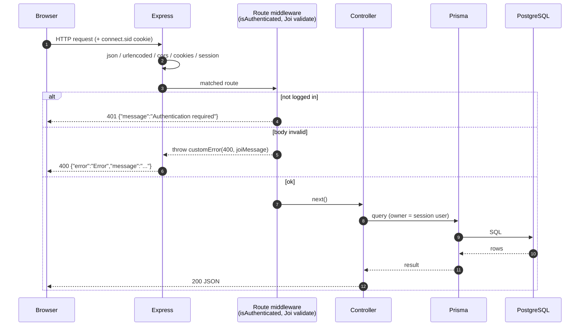

### 6.4 Sessions and authentication

- On successful **login or signup** the controller stores `req.session.user` (the user without the password hash) and
  `req.session.session_id` (the user's UUID).
- `isAuthenticated` only checks that `req.session.session_id` exists.
- CRM controllers read the **owner from the session**, never from the request body, so a client cannot create or read
  records on behalf of someone else.
- Sessions are held in the default in-memory store: they are lost on restart and are not shared between multiple
  server instances (see [12](#12-security-notes) and [14](#14-known-limitations-and-recommended-follow-ups)).

### 6.5 Error handling

Two mechanisms coexist:

1. **Central handler (for thrown errors).** Validation middleware and the company-AUM controller throw
   `customError(status, message)`; `wrapAsync` forwards rejected promises. The handler answers
   `{ "error": "<err.name>", "message": "<text>" }`. Because `customError` does not set a custom `name`, `error` is
   `"Error"`.
2. **Controller-local `try/catch` (for CRUD controllers).** Controllers answer directly with
   `{ "error": "<summary>" }` for expected conditions (not found, forbidden) and
   `{ "error": "Internal server error", "message": "<exception text>" }` with status `500` for unexpected failures.

Clients should therefore read `message` **or** `error` when displaying a failure (see [8.1](#81-conventions)).

---

## 7. Data Model

PostgreSQL schema managed by Prisma (`server/prisma/schema.prisma`). Primary keys are UUID v7 strings
(`@default(uuid(7))`), generated by Prisma.

### 7.1 Entity-relationship overview

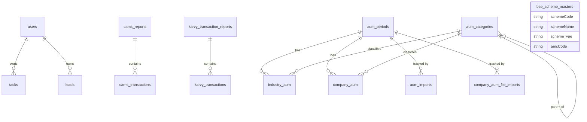

Domain groups:

| Group | Tables | Written by |
|---|---|---|
| CRM | `users`, `tasks`, `leads` | API controllers, `dateStatusJob` |
| CAMS transactions | `cams_reports`, `cams_transactions` | CAMS transactions pipeline |
| Karvy transactions | `karvy_transaction_reports`, `karvy_transactions` | Karvy transactions pipeline |
| AUM | `aum_periods`, `aum_categories`, `industry_aum`, `company_aum`, `company_aum_file_imports`, `aum_imports` | AMFI job, CAMS/Karvy AUM pipelines, manual import API |
| Reference | `bse_scheme_masters` | BSE scheme master job |

### 7.2 CRM models

#### `users`

| Column | Type | Notes |
|---|---|---|
| `id` | String (UUID v7) | PK |
| `name` | String | |
| `username` | String | Not unique |
| `email` | String | **Unique** — used to log in |
| `password` | String | bcrypt hash (cost 12) |
| `role` | String | Free text supplied at sign-up |
| `createdAt` | DateTime | default `now()` |

Relations: one user has many `tasks` and many `leads` (`onDelete: Cascade` — deleting a user deletes their tasks and leads).

#### `tasks`

| Column | Type | Notes |
|---|---|---|
| `id` | String (UUID v7) | PK |
| `title` | String | |
| `description` | String | Required column (the validator allows an empty string) |
| `clientId` | String | Plain string today; intended to become a foreign key to a future `Client` model |
| `category` | String | Free text |
| `priority` | String | Validator allows `High`, `Medium`, `Low` |
| `status` | String | Validator allows `Open`, `In progress`, `Closed` |
| `dueDate` | DateTime | |
| `dueDateLabel` | String | Default `"Upcoming"`; maintained by `dateStatusJob` (`Expired`, `Today`, `Tomorrow`, `DD Mon`) |
| `createdAt` | DateTime | default `now()` |
| `userId` | String | FK → `users.id`, cascade delete; set from the session |

#### `leads`

| Column | Type | Notes |
|---|---|---|
| `id` | String (UUID v7) | PK |
| `name` | String | |
| `email` | String | **Unique** (globally, across all owners) |
| `mobile` | String | **Unique** |
| `pan` | String | **Unique** |
| `interested` | String | Product interest |
| `lead_value` | String | Stored as text |
| `status` | String | |
| `source` | String | |
| `nature` | String | |
| `follow_up_date` | DateTime | |
| `follow_up_label` | String | Default `"Upcoming"`; maintained by `dateStatusJob` |
| `reminder` | Boolean | |
| `description` | String | |
| `documents` | String[] | File names stored in `uploads/` |
| `clientId` | String? | Optional, same future-proofing as tasks |
| `userId` | String | FK → `users.id`, cascade delete; set from the session |

> Because `email`, `mobile` and `pan` are globally unique, creating a lead that duplicates any of them (even one owned by
> another user) fails with a database error that surfaces as HTTP 500 (see [8.4](#84-leads)).

### 7.3 CAMS transaction models

#### Enum `CamsReportStatus`

`RECEIVED`, `PARSED`, `STORED`, `SKIPPED`, `FAILED`

#### `cams_reports` — one row per report e-mail

| Column | Type | Notes |
|---|---|---|
| `id` | String | PK |
| `messageId` | String? | **Unique** — the e-mail Message-ID |
| `identifierFingerprint` | String | **Unique** — SHA-256 of `messageId`, `reportRequestNumber`, `reportNumber`, `dispatchDateTime`, `toEmail` |
| `reportRequestNumber`, `reportNumber` | String? | CAMS identifiers (indexed on request number) |
| `dispatchDateTime` | DateTime? | Indexed |
| `toEmail` | String? | |
| `status` | `CamsReportStatus` | Final outcome |
| `error` | String? | Why a report was not stored |
| `transactionCount` | Int | Default 0 |
| `processingAttempts` | Int | Default 1; incremented on each reprocess |
| `parsedAt`, `storedAt` | DateTime? | |
| `createdAt`, `updatedAt` | DateTime | |

#### `cams_transactions` — one row per transaction line

- `id`, `reportId` (FK → `cams_reports`, cascade), `fingerprint` (SHA-256 over all CAMS fields), `createdAt`.
- **Unique** `(reportId, fingerprint)`; indexes on `folioNo`, `pan`, `trxnno`.
- About 80 business columns, one per CAMS CSV header, **all stored as nullable strings** (no raw JSON/CSV is kept). Examples:

| CSV header | Column | CSV header | Column |
|---|---|---|---|
| `AMC_CODE` | `amcCode` | `FOLIO_NO` | `folioNo` |
| `PRODCODE` | `prodcode` | `SCHEME` | `scheme` |
| `INV_NAME` | `invName` | `PAN` | `pan` |
| `TRXNTYPE` | `trxntype` | `TRXNNO` | `trxnno` |
| `TRADDATE` | `traddate` | `POSTDATE` | `postdate` |
| `UNITS` | `units` | `AMOUNT` | `amount` |
| `PURPRICE` | `purprice` | `BROKCODE` | `brokcode` |
| `BROKCOMM` | `brokcomm` | `EUIN` | `euin` |
| `SUB_BRK_ARN` | `subBrkArn` | `STT` | `stt` |

The complete header → column map is `CAMS_TRANSACTION_FIELDS` in `utils/cams_transactions/camsPersistence.js`.

### 7.4 Karvy transaction models

Deliberately **separate tables** that mirror the CAMS design (same status lifecycle, same fingerprint idempotency, same
"every field is a string" convention). KFintech's CSV has about 90 differently named columns, so the two cannot share a table.

| Table | Highlights |
|---|---|
| `karvy_transaction_reports` | Same columns as `cams_reports`; status enum `KarvyReportStatus` (`RECEIVED`, `PARSED`, `STORED`, `SKIPPED`, `FAILED`). |
| `karvy_transactions` | `reportId` FK (cascade), `fingerprint`, unique `(reportId, fingerprint)`, indexes on `folioNumber`, `pan1`, `transactionNumber`. Columns include `productCode`, `fund`, `folioNumber`, `schemeCode`, `fundDescription`, `transactionHead`, `transactionNumber`, `investorName`, `transactionDate`, `price`, `units`, `amount`, `agentCode`, `commission`, `pan1`–`pan3`, `nav`, `stt`, `tdsAmount`, `isin`, `euin`, `subBrokerArnCode`, `stampDutyCharges`, `utrNo`, `bankAcno` and more. |

### 7.5 AUM models

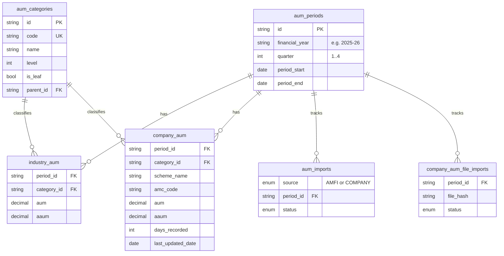

| Table | Meaning | Key constraints |
|---|---|---|
| `aum_periods` | One financial quarter (`financial_year` like `2025-26`, `quarter` 1–4, `period_start`, `period_end`). | Unique `(financial_year, quarter)`; index on `period_end`. |
| `aum_categories` | Hierarchical category tree (`code` unique, `name`, `level`, `is_leaf`, self-reference `parent_id`). Holds both the AMFI tree (levels 1–4) and the flat company categories (level 1, no parent). | Unique `code`; indexes on `parent_id`, `level`. |
| `industry_aum` | AMFI industry AUM/AAUM per category per quarter (`Decimal(20,4)`). | Unique `(period_id, category_id)`; category delete is `Restrict`. |
| `company_aum` | **The company's AUM per fund per quarter.** `scheme_name` is the canonical master-list name (the row's identity); `amc_code` nullable; `aum`, `aaum` `Decimal(20,4)`; `days_recorded` and `last_updated_date` drive the daily update logic. | Unique `(period_id, scheme_name)`; indexes on `category_id`, `period_id`, `amc_code`. |
| `company_aum_file_imports` | One row per processed company file (CAMS, Karvy or manual): `file_name`, **`file_hash`** (SHA-256 of the bytes), `arn_no`, `report_from_date`, `report_to_date`, `status`, `matched_scheme_count`, `unmatched_scheme_count`, `total_closing_assets`, `error_message`, `completed_at`. | Unique `(period_id, file_hash)` — gives duplicate-file protection. |
| `aum_imports` | One row per `(source, period)` tracking AMFI downloads: `source` (`AMFI` or `COMPANY`), `file_url`, `file_name`, `status`, `started_at`, `completed_at`, `error_message`. The AMFI job treats `COMPLETED` as "do not touch again". | Unique `(source, period_id)`. |

Enum `AumImportStatus`: `PENDING → DOWNLOADING → PROCESSING → COMPLETED` or `FAILED`.
Enum `AumImportSource`: `AMFI`, `COMPANY` (only `AMFI` is written by current code; company files use `company_aum_file_imports`).

> Both industry and company data reference the **same** `aum_periods` and `aum_categories` tables. That is what makes an
> industry-versus-company comparison a simple join.

### 7.6 BSE scheme master

`bse_scheme_masters` stores the full daily BSE StAR MF scheme master, one row per scheme/plan, with 43 parsed columns
(snake_case in the database): `unique_no`, `scheme_code` (required), `rta_scheme_code`, `amc_scheme_code`, `isin`,
`amc_code`, `scheme_type`, `scheme_plan`, `scheme_name` (required), purchase/redemption flags and limits, cut-off times,
`rta_agent_code`, `amc_active_flag`, SIP/STP/SWP/switch flags, `settlement_type`, `face_value`, `start_date`, `end_date`,
exit-load and lock-in fields, `channel_partner_code`, `reopening_date`. Indexes on `scheme_code`, `isin`, `scheme_name`,
`amc_code`. The table is **fully replaced** on every sync (delete all, then bulk insert in batches of 1000, inside one
transaction with a 60-second timeout).

Only three columns are used by the AUM matching logic: `scheme_name`, `scheme_type` (becomes the category) and `amc_code`.

### 7.7 Migrations history

| Migration | What it does (verified from the SQL) |
|---|---|
| `20260817082522_init` | Creates the first `User` table |
| `20260817092033_change_user_id_to_uuid` | Rebuilds the user primary key as a UUID |
| `20260817130914_add_user_role` | Adds `role` to users |
| `20260817134923_added_task_model` | Creates the `Task` table |
| `20260817143719_added_cascade_for_deletion` | Re-creates the task foreign key with cascade delete |
| `20260818091508_added_labels_for_cron_job` | Creates the `Lead` table and adds `dueDateLabel` to tasks |
| `20260824110000_add_cams_report_ingestion` | Creates `cams_reports`, `cams_transactions` and enum `CamsReportStatus` |
| `20260829104428_added` | Creates `aum_periods`, `aum_categories`, `industry_aum`, `company_aum` (original category-level shape), `aum_imports` and enums `AumImportSource`, `AumImportStatus` |
| `20260907093839_added_company_aum_persistance_logic` | Creates `company_aum_file_imports`; temporarily adds `scheme_count` / `scheme_fingerprints` to `company_aum` |
| `20260920070244_added_aum_transactions_update` | Creates `karvy_transaction_reports`, `karvy_transactions`, enum `KarvyReportStatus`; reshapes `company_aum` to one row per fund (`scheme_name`, `amc_code`, `days_recorded`, `last_updated_date`, unique `(period_id, scheme_name)`) and drops the temporary columns |
| `20260922092826_changed_user_table_name` | Renames the user table (drop and re-create) |
| `20260922093208_changed_table_names` | Moves to lower-case table names `users`, `tasks`, `leads` (drop and re-create) |
| `20260922104949_task_lead_owner_refactor` | Adds `userId` to tasks, replaces `primary_user` on leads with `userId`, re-points the foreign keys at `users` |

Apply with `npx prisma migrate deploy`. `migration_lock.toml` pins the provider to PostgreSQL.

> **Schema / migration drift — action required before a fresh install.**
> `schema.prisma` currently contains objects that **no migration creates**:
>
> | Object in `schema.prisma` | Present in a migration? |
> |---|---|
> | table `bse_scheme_masters` (model `BseSchemeMaster`) | **No** |
> | `company_aum_file_imports.arn_no` (+ its index), `report_from_date`, `report_to_date` | **No** |
>
> A database built **only** from `prisma migrate deploy` will therefore lack these, and the BSE master job and the company-AUM
> imports will fail with "table/column does not exist". An existing development database that was synchronised another way
> (for example `prisma db push`) works, which is why the application appears healthy locally.
> Fix: on a database that has all 13 migrations applied, run
> `npx prisma migrate dev --name sync_bse_master_and_file_import_columns`, review the generated SQL, and commit the new
> folder under `prisma/migrations/`. See [14](#14-known-limitations-and-recommended-follow-ups).

### 7.8 AUM category seed

`prisma/seed/aumCategoryData.js` is a hand-verified transcription of AMFI's category tree (taken from a real AMFI
quarterly file). Each entry has `code`, `name` (exact AMFI wording, including its inconsistent trailing spaces),
`level`, `isLeaf` and `parentCode`.

| Level | Meaning | Example |
|---|---|---|
| 1 | Top-level scheme type | Open Ended Schemes · Close Ended Schemes · Interval Schemes |
| 2 | Scheme orientation | Income/Debt Oriented Schemes |
| 3 | Sub-section (only under Open Ended → Income/Debt) | Liquid/Cash Oriented Schemes |
| 4 | **Leaf** — receives AUM/AAUM figures | Overnight Fund · Large Cap Fund |

The same name can appear under several parents (for example *Other Schemes*), each being a different category — which is why
categories are always resolved by **(parent, name)**, never by name alone. The seeder upserts by `code`, is safe to re-run,
and the AMFI ingestion creates any brand-new AMFI category automatically.

---

## 8. API Reference

### 8.1 Conventions

| Topic | Rule |
|---|---|
| Base URL | `http://localhost:5000` (set by `PORT`) |
| Content type | JSON (`application/json`) for auth and tasks; `multipart/form-data` for leads (with files) and the company-AUM import |
| Authentication | Cookie session. Log in once, then send the `connect.sid` cookie on every call. Browsers must use `credentials: 'include'` (CORS allows `http://localhost:5173` with credentials). |
| Authorization model | **Owner-scoped**: tasks and leads are read, changed and deleted only by the user who owns them (the owner is taken from the session). |
| IDs | UUID v7 strings |
| Dates | ISO-8601 strings in JSON (`2026-10-15T00:00:00.000Z`) |
| Unknown body fields | Rejected by Joi with `400` for leads/tasks/auth (`"<field>" is not allowed`). Analytics allows unknown fields. |

**Status codes used**

| Code | Meaning in this API |
|---|---|
| `200` | Success (also used for creates) |
| `400` | Validation failed, or a required id/field is missing |
| `401` | Not logged in |
| `403` | Logged in, but the record belongs to another user |
| `404` | Record not found. **Also used by login/signup for "wrong password" and "user already exists".** |
| `422` | (Import jobs only) unprocessable file content — appears inside per-file results, not as a top-level status |
| `500` | Unexpected error (including database constraint violations) |

**Error body shapes** (clients should tolerate all three)

```jsonc
// 1) Validation / thrown errors (central handler)
{ "error": "Error", "message": "\"email\" must be a valid email" }

// 2) Expected conditions from controllers
{ "error": "Task not found" }

// 3) Unexpected failures from controllers
{ "error": "Internal server error", "message": "<exception text>" }

// 4) Auth guard
{ "message": "Authentication required" }
```

**Calling the API with `curl`** — keep the session in a cookie jar:

```bash
curl -c jar.txt -H "Content-Type: application/json" \
  -d '{"email":"admin@example.com","password":"S3cret!"}' \
  http://localhost:5000/api/auth/login

curl -b jar.txt http://localhost:5000/api/tasks/getTasks
```

---

### 8.2 Health

#### `GET /`

| | |
|---|---|
| Auth | None |
| Controller | inline in `index.js` |
| Response `200` | `{ "message": "Server is functional" }` |

---

### 8.3 Authentication and Users

Route file: `routes/authentication.js` · Controller: `controllers/authentication.js` · Mount: `/api/auth`

#### `POST /api/auth/signup`

Creates a user and **logs them in immediately**.

| | |
|---|---|
| Auth | None (public) |
| Middleware | `SignupValidate` |
| Content type | `application/json` |

Request body (all required, strings):

| Field | Notes |
|---|---|
| `name` | Display name |
| `username` | Not unique |
| `email` | Must be unique (not format-checked by the validator) |
| `password` | Hashed with bcrypt (cost 12) before storing |
| `role` | Free text (e.g. `admin`) — **supplied by the client** |

```json
{
  "name": "Asha Verma",
  "username": "asha",
  "email": "asha@example.com",
  "password": "S3cret!",
  "role": "admin"
}
```

Success `200` (session cookie set):

```json
{
  "message": "Successful sign up and user auto login",
  "user": {
    "id": "0192f8c4-7a31-7c52-9d0e-3b6d2f1a4c10",
    "name": "Asha Verma",
    "username": "asha",
    "email": "asha@example.com",
    "role": "admin",
    "createdAt": "2026-10-11T06:30:12.000Z"
  }
}
```

Errors: `400` validation · `404 {"error":"User already exists. Please try a different account"}` · `500`.

#### `POST /api/auth/login`

| | |
|---|---|
| Auth | None |
| Middleware | `LoginValidate` (`email`, `password` required strings) |

```json
{ "email": "asha@example.com", "password": "S3cret!" }
```

Success `200` (session cookie set):

```json
{
  "message": "User logged in Successfully",
  "user": { "id": "0192f8c4-…", "name": "Asha Verma", "username": "asha", "email": "asha@example.com", "role": "admin", "createdAt": "2026-10-11T06:30:12.000Z" }
}
```

Errors: `404 {"error":"Cannot find user with email <email>"}` · `404 {"error":"Password does not match . Please provide correct password"}` · `400` · `500`.

#### `GET /api/auth/isAuthenticated`

Used by the UI on boot to restore a session.

| | |
|---|---|
| Auth | Reads the session; does not require it |
| Response `200` | `{ "message": "Authenticated", "user": { …cached session user… } }` |
| Response `401` | `{ "message": "Not authenticated", "user": null }` |

#### `GET /api/auth/getUsers`

| | |
|---|---|
| Auth | Required |
| Response `200` | `{ "message": "Successfully retrieved users", "users": [ { …user, "tasks": [ …task objects… ] } ] }` |

> **Heads-up:** the user objects in this response are returned as stored and **include the `password` hash field**, and any
> logged-in user can list all users. See [12](#12-security-notes).

#### `GET /api/auth/getUser/:id`

| | |
|---|---|
| Auth | Required |
| Path param | `id` — user UUID |
| Response `200` | `{ "message": "Successfully retrieved user using id", "user": { …user, "tasks": [ … ] } }` |
| Errors | `404 {"error":"User does not exist for given id"}` · `500` |

(The same note about the `password` field applies.)

#### `GET /api/auth/logout`

| | |
|---|---|
| Auth | Required |
| Effect | Destroys the session and clears the `connect.sid` cookie |
| Response `200` | `{ "message": "Logged out successfully" }` |
| Error `500` | `{ "message": "Logout failed" }` |

---

### 8.4 Leads

Route file: `routes/leads.js` · Controller: `controllers/leads.js` · Mount: `/api/leads`

- A lead belongs to the user who created it (`userId` from the session; the client can never set it).
- Create/update use **`multipart/form-data`** so documents can be attached in the field **`files`** (any number).
  Uploaded files are written to `uploads/` **under their original file name**; only the names are stored in `documents`.
- Text fields arrive as strings; Joi converts `reminder` (`"true"`/`"false"`) and `follow_up_date` automatically.

Lead fields (validator `utils/ValidateLead.js`):

| Field | Type | Required | Notes |
|---|---|---|---|
| `id` | string | Update only | Lead to change |
| `name` | string | Yes | |
| `email` | string (e-mail) | Yes | Globally unique |
| `mobile` | string | Yes | Globally unique |
| `pan` | string | Yes | Globally unique |
| `interested` | string | Yes | |
| `lead_value` | string | Yes | |
| `status` | string | Yes | |
| `source` | string | Yes | |
| `nature` | string | Yes | |
| `follow_up_date` | date | Yes | |
| `reminder` | boolean | Yes | |
| `description` | string | Yes | |
| `documents` | string[] | No | Not normally sent; filled from uploads |
| `clientId` | string / null / `""` | No | Empty becomes `null` |

Lead object returned by the API:

```json
{
  "id": "0192f8d1-…",
  "name": "Rohit Sharma",
  "email": "rohit@example.com",
  "mobile": "9876543210",
  "interested": "SIP",
  "lead_value": "500000",
  "pan": "ABCDE1234F",
  "status": "New",
  "source": "Referral",
  "nature": "Hot",
  "follow_up_date": "2026-10-15T00:00:00.000Z",
  "follow_up_label": "Upcoming",
  "reminder": true,
  "description": "Wants to start a monthly SIP",
  "documents": ["kyc.pdf"],
  "clientId": null,
  "userId": "0192f8c4-…"
}
```

#### `POST /api/leads/create`

| | |
|---|---|
| Auth | Required |
| Middleware order | `multer` → `isAuthenticated` → `LeadValidate` |
| Body | `multipart/form-data`: the fields above + `files` |

```bash
curl -b jar.txt -X POST http://localhost:5000/api/leads/create \
  -F name="Rohit Sharma" -F email=rohit@example.com -F mobile=9876543210 \
  -F pan=ABCDE1234F -F interested=SIP -F lead_value=500000 -F status=New \
  -F source=Referral -F nature=Hot -F follow_up_date=2026-10-15 \
  -F reminder=true -F description="Wants to start a monthly SIP" \
  -F files=@kyc.pdf
```

Success `200`:

```json
{ "message": "Lead generated for user Asha Verma successfully", "lead": { …lead object… } }
```

Errors: `400` validation · `401` · `404 {"error":"Logged-in user not found"}` · `500` (including duplicate `email`/`mobile`/`pan`).

#### `PATCH /api/leads/update`

| | |
|---|---|
| Auth | Required (owner only) |
| Body | Same fields as create, plus **`id`** (all other required fields must be sent again) |
| Documents | New uploads are **appended** to the existing `documents` array |

Success `200`: `{ "message": "Lead updated for user <userId> successfully", "lead": { … } }`
Errors: `400 {"error":"Lead ID not provided"}` · `403 {"error":"Not allowed to edit this lead"}` · `404 {"error":"Lead not found"}`.

#### `GET /api/leads/getLeads`

Returns the caller's leads ordered by `follow_up_date` ascending.

```json
{ "message": "Successfully fetched your leads", "leads": [ { … }, { … } ] }
```

#### `GET /api/leads/lead/:leadId`

Success: `{ "message": "Successfully fetched lead", "lead": { … } }`
Errors: `403 {"error":"Not allowed to view this lead"}` · `404 {"error":"Lead not found"}`.

#### `DELETE /api/leads/delete/:leadId`

Success: `{ "message": "Successfully deleted lead" }`
Errors: `403 {"error":"Not allowed to delete this lead"}` · `404 {"error":"Lead not found"}`.
(Uploaded files in `uploads/` are **not** deleted.)

---

### 8.5 Tasks

Route file: `routes/tasks.js` · Controller: `controllers/tasks.js` · Mount: `/api/tasks` · Body: `application/json`

Task fields (validator `utils/ValidateTask.js`):

| Field | Type | Required | Allowed values |
|---|---|---|---|
| `id` | string | Update only | |
| `title` | string | Yes | |
| `description` | string | No (may be `""`) | |
| `clientId` | string | Yes | Plain string (future FK) |
| `category` | string | Yes | |
| `priority` | string | Yes | `High`, `Medium`, `Low` |
| `status` | string | Yes | `Open`, `In progress`, `Closed` |
| `dueDate` | date | Yes | |

Task object returned:

```json
{
  "id": "0192f8e0-…",
  "title": "Collect KYC from Rohit",
  "description": "",
  "clientId": "C-1001",
  "category": "Onboarding",
  "priority": "High",
  "status": "Open",
  "dueDate": "2026-10-14T00:00:00.000Z",
  "dueDateLabel": "Upcoming",
  "createdAt": "2026-10-11T07:00:00.000Z",
  "userId": "0192f8c4-…"
}
```

> `dueDateLabel` is **not** computed on create/update; it stays `"Upcoming"` until the 08:00 IST `dateStatusJob` runs.

#### `POST /api/tasks/create`

Request:

```json
{
  "title": "Collect KYC from Rohit",
  "description": "",
  "clientId": "C-1001",
  "category": "Onboarding",
  "priority": "High",
  "status": "Open",
  "dueDate": "2026-10-14"
}
```

Success `200`: `{ "message": "Task generated for user Asha Verma successfully", "task": { … } }`
Errors: `400` · `401` · `404 {"error":"Cannot generate Task. Logged-in user not found."}` · `500`.

#### `PATCH /api/tasks/update`

Send the full task body **including `id`** (the validator requires every mandatory field again).
Success: `{ "message": "Task updated successfully", "task": { … } }`
Errors: `400 {"error":"Task ID not provided"}` · `403 {"error":"Not allowed to edit this task"}` · `404 {"error":"Task not found"}`.

#### `GET /api/tasks/getTasks`

Caller's tasks ordered by `dueDate` ascending: `{ "message": "Successfully fetched your tasks", "tasks": [ … ] }`.

#### `GET /api/tasks/task/:taskId`

Success: `{ "message": "Successfully fetched task", "task": { … } }`
Errors: `400 {"error":"Task Id not provided"}` · `403 {"error":"Not allowed to view this task"}` · `404 {"error":"Task not found"}`.

#### `DELETE /api/tasks/delete/:taskId`

Success: `{ "message": "Successfully deleted task" }`
Errors: `403 {"error":"Not allowed to delete this task"}` · `404 {"error":"Task not found"}`.

---

### 8.6 Company AUM import

Route file: `routes/companyAum.js` · Controller: `controllers/companyAum.js` · Service: `services/cams_wbr22/companyAumIngestionService.js`

#### `POST /api/company-aum/import`

Manually imports one or more **CAMS WBR22** files for one reporting quarter. The same engine is used by the daily cron
jobs; this endpoint exists for back-fills and corrections.

| | |
|---|---|
| Auth | Required |
| Content type | `multipart/form-data` |
| Storage | Files are read into memory (`multer.memoryStorage()`) and never written to disk |

Form fields:

| Field | Type | Required | Description |
|---|---|---|---|
| `files` | file (repeatable) | Yes, at least one | WBR22 CSV exports from CAMS |
| `quarterDate` | ISO date string | Yes | Any date inside the target quarter, e.g. `2026-09-30`; converted to financial year + quarter |

```bash
curl -b jar.txt -X POST http://localhost:5000/api/company-aum/import \
  -F quarterDate=2026-09-30 \
  -F files=@wbr22_part1.csv -F files=@wbr22_part2.csv
```

What happens, per file:

1. SHA-256 of the file bytes → if an identical file was already **COMPLETED** for that quarter → `SKIPPED_DUPLICATE`.
2. Parse WBR22 → total `CLOSING_ASSETS` per scheme.
3. Match every scheme name to the BSE master (category + AMC); unmatched funds go to category `Other`.
4. In one DB transaction, apply each fund with the three-case rule ([9.10](#910-how-company-aum-is-calculated)).
5. Mark the file import `COMPLETED` (or `FAILED` with the error).

Success `200`:

```json
{
  "financialYear": "2026-27",
  "quarter": 2,
  "periodId": "0192fa00-…",
  "files": [
    {
      "fileName": "wbr22_part1.csv",
      "status": "COMPLETED",
      "matchedSchemeCount": 41,
      "unmatchedSchemeCount": 2,
      "totalClosingAssets": 125430987.55,
      "fundsUpdated": [
        {
          "schemeName": "HDFC FLEXI CAP FUND",
          "category": "EQUITY",
          "amcCode": "HDFCMutualFund_MF",
          "aum": 2500000.12,
          "aaum": 2500000.12,
          "daysRecorded": 1,
          "caseApplied": "NEW_ROW"
        }
      ],
      "unmatchedSchemes": [
        {
          "originalSchemeName": "Some Legacy Fund - Reg Growth",
          "closingAssets": 1200.5,
          "bestGuessMatch": "SOME LEGACY FUND",
          "bestGuessScore": 0.874,
          "assignedCategory": "Other"
        }
      ]
    },
    {
      "fileName": "wbr22_part2.csv",
      "status": "SKIPPED_DUPLICATE",
      "message": "This exact file has already been imported for this quarter."
    }
  ]
}
```

Per-file `status`: `COMPLETED` · `SKIPPED_DUPLICATE` · `FAILED` (with `error`).
`caseApplied`: `NEW_ROW` · `SAME_DAY_ADD` · `NEW_DAY_OVERWRITE`.

Top-level errors: `400 "At least one WBR22 file is required (field name \"files\")"` ·
`400 "quarterDate (an ISO date string) is required to identify the reporting quarter"` · `401` · `500`.

> This endpoint understands the **CAMS** WBR22 layout (`SCHEME_NAME`, `CLOSING_ASSETS`). A KFintech ClientWise AUM file
> uploaded here would fail with *"missing the required SCHEME_NAME/CLOSING_ASSETS columns"* inside the file result;
> Karvy files are processed by the Karvy cron job instead.

---

### 8.7 Analytics

Route file: `routes/analytics.js` · Controller: `controllers/analytics.js` · Mounted at **both** `/api/analytics` and `/analytics`.

All four analytics paths accept **GET and POST** and require a session. They return the **company's** AUM/AAUM for the
*latest quarter that has company data*.

**Which period is used** (`getLatestAvailableAumPeriod`):

1. Work out the financial year and quarter of *today*.
2. If that `aum_periods` row exists and has at least one `company_aum` row → use it.
3. Otherwise use the most recent period (by `period_end`) that has any `company_aum` rows.
4. If there is no company data at all → `period: null`, `data: []`.

Optional inputs (validated by `ValidateAnalytics`, merged from `req.query` and `req.body`):

| Field | Type | Current effect |
|---|---|---|
| `periodId` | string | Accepted and validated, **not used** by the controllers yet |
| `limit` | positive integer | Accepted and validated, **not used** by the controllers yet |

Any other field is allowed and ignored.

#### `GET|POST /api/analytics/performance_amc`

Total AUM and AAUM grouped by `amcCode`, ordered by AUM descending.

```bash
curl -b jar.txt http://localhost:5000/api/analytics/performance_amc
```

Response `200`:

```json
{
  "message": "Successfully fetched AMC performance analytics",
  "period": {
    "id": "0192fa00-…",
    "financialYear": "2026-27",
    "quarter": 2,
    "periodStart": "2026-07-01",
    "periodEnd": "2026-09-30"
  },
  "data": [
    { "amc": "HDFCMutualFund_MF", "amcCode": "HDFCMutualFund_MF", "aum": 12500000.5, "aaum": 12100000.25 },
    { "amc": "UNKNOWN", "amcCode": null, "aum": 450000, "aaum": 450000 }
  ]
}
```

Funds without a resolved AMC are grouped under `amc: "UNKNOWN"` with `amcCode: null`.

#### `GET|POST /api/analytics/performance_category` (alias `/performance_catagory`)

Total AUM and AAUM grouped by category, ordered by AUM descending. The misspelt path `performance_catagory` is kept as an
alias for existing clients; both spellings call the same handler.

Response `200`:

```json
{
  "message": "Successfully fetched category performance analytics",
  "period": { "id": "0192fa00-…", "financialYear": "2026-27", "quarter": 2, "periodStart": "2026-07-01", "periodEnd": "2026-09-30" },
  "data": [
    { "catagory": "EQUITY", "category": "EQUITY", "categoryCode": "EQUITY", "categoryId": "0192f900-…", "aum": 9800000, "aaum": 9400000 },
    { "catagory": "DEBT",   "category": "DEBT",   "categoryCode": "DEBT",   "categoryId": "0192f901-…", "aum": 2700000, "aaum": 2650000 }
  ]
}
```

Each item carries both `catagory` (legacy spelling) and `category`. If a category id cannot be resolved the name is `"UNKNOWN"`.

**Notes on numbers:** `aum`/`aaum` are `Decimal(20,4)` in the database converted to JavaScript numbers; they are returned in
the unit supplied by the registrar files (no currency conversion is applied). `periodStart`/`periodEnd` are date-only values.

Errors for all analytics paths: `400` (validation) · `401` · `500 {"error":"Internal server error","message":"…"}`.

---

### 8.8 Endpoint summary table

| # | Method | Path | Auth | Body | Controller |
|---|---|---|---|---|---|
| 1 | GET | `/` | No | – | inline |
| 2 | POST | `/api/auth/signup` | No | JSON | `signup` |
| 3 | POST | `/api/auth/login` | No | JSON | `login` |
| 4 | GET | `/api/auth/getUsers` | Yes | – | `getUsers` |
| 5 | GET | `/api/auth/getUser/:id` | Yes | – | `getSingleUser` |
| 6 | GET | `/api/auth/logout` | Yes | – | `logout` |
| 7 | GET | `/api/auth/isAuthenticated` | Session read | – | `isAuthenticatedController` |
| 8 | POST | `/api/leads/create` | Yes | multipart | leads `create` |
| 9 | PATCH | `/api/leads/update` | Yes (owner) | multipart | leads `update` |
| 10 | GET | `/api/leads/getLeads` | Yes | – | leads `getAll` |
| 11 | GET | `/api/leads/lead/:leadId` | Yes (owner) | – | leads `getSingle` |
| 12 | DELETE | `/api/leads/delete/:leadId` | Yes (owner) | – | leads `remove` |
| 13 | POST | `/api/tasks/create` | Yes | JSON | tasks `create` |
| 14 | PATCH | `/api/tasks/update` | Yes (owner) | JSON | tasks `update` |
| 15 | GET | `/api/tasks/getTasks` | Yes | – | tasks `getAll` |
| 16 | GET | `/api/tasks/task/:taskId` | Yes (owner) | – | tasks `getSingle` |
| 17 | DELETE | `/api/tasks/delete/:taskId` | Yes (owner) | – | tasks `remove` |
| 18 | POST | `/api/company-aum/import` | Yes | multipart | `importCompanyAum` |
| 19 | GET/POST | `/api/analytics/performance_amc` (+ `/analytics/…`) | Yes | optional | `getPerformanceAmc` |
| 20 | GET/POST | `/api/analytics/performance_category` (+ `/analytics/…`) | Yes | optional | `getPerformanceCategory` |
| 21 | GET/POST | `/api/analytics/performance_catagory` (+ `/analytics/…`) | Yes | optional | `getPerformanceCategory` |

> **Scope note:** this codebase has no endpoints for a separate "company agent" entity. The business domains exposed over HTTP
> are users/authentication, leads, tasks, company-AUM import and analytics. Everything else (CAMS, KFintech, BSE, AMFI) runs as
> background jobs documented in the next section.

---

## 9. Scheduled Jobs and Ingestion Pipelines

### 9.1 Job registry and daily timeline

All schedules use `node-cron` with `timezone: "Asia/Kolkata"`, so they fire at the same IST wall-clock time regardless of the
server's own time zone. Every job file is loaded by `index.js`, so **starting the server arms all jobs**.

| # | Job file | Cron | When (IST) | Purpose | Reads | Writes |
|---|---|---|---|---|---|---|
| 1 | `bseStarSchemeMasterIngestionJob.js` | `0 1 * * *` | Daily 01:00 | Refresh the BSE scheme master | BSE StAR MF website | `bse_scheme_masters` |
| 2 | `camsIngestionJob.js` | `0 8 * * *` | Daily 08:00 | CAMS transactions | Gmail → CAMS ZIP | `cams_reports`, `cams_transactions` |
| 3 | `dateStatusJob.js` | `0 8 * * *` | Daily 08:00 | Refresh date labels | DB | `tasks.dueDateLabel`, `leads.follow_up_label` |
| 4 | `karvyTransactionIngestionJob.js` | `30 8 * * *` | Daily 08:30 | Karvy transactions | Gmail → KFintech ZIP | `karvy_transaction_reports`, `karvy_transactions` |
| 5 | `wbr22AumIngestionJob.js` | `30 11 * * *` | Daily 11:30 | CAMS company AUM | Gmail → CAMS ZIP, BSE master (DB) | `company_aum`, `company_aum_file_imports`, `aum_periods`, `aum_categories` |
| 6 | `karvyWbr22AumIngestionJob.js` | `0 12 * * *` | Daily 12:00 | Karvy company AUM | Gmail → KFintech ZIP, BSE master (DB) | same as #5 |
| 7 | `amfiIngestionJob.js` | `0 8 1 * *` | 1st of each month, 08:00 | AMFI industry AUM | AMFI API + XLSX | `industry_aum`, `aum_imports`, `aum_periods`, `aum_categories` |

```mermaid
gantt
    title Daily job schedule (IST) — bars mark the start time only
    dateFormat HH:mm
    axisFormat %H:%M
    section Reference data
    BSE scheme master sync        :milestone, bse, 01:00, 0m
    section Morning
    CAMS transactions             :milestone, cams, 08:00, 0m
    Date labels (tasks and leads) :milestone, dates, 08:00, 0m
    AMFI industry AUM (1st of month) :milestone, amfi, 08:00, 0m
    Karvy transactions            :milestone, karvy, 08:30, 0m
    section Late morning
    CAMS AUM (WBR22)              :milestone, cwbr, 11:30, 0m
    Karvy AUM (ClientWise)        :milestone, kwbr, 12:00, 0m
```

**Why the order matters**

- The BSE master is refreshed at **01:00**, hours before the two AUM jobs, so fund-to-category matching always uses a fresh list.
- The two transaction jobs are 30 minutes apart, and the two AUM jobs are 30 minutes apart, so they do not hold the Gmail
  mailbox lock at the same time (a comment in the Karvy jobs states this intent).
- The AUM jobs run in the late morning to give the RTAs' e-mails time to arrive.

**Overlap protection.** Each ingestion job file keeps a module-level `running` flag. If a run is still in progress when the
next trigger fires (or someone calls the exported function manually), the new call returns
`{ skipped: true, reason: "already-running" }` instead of starting a second run. The flag is per process; it does not
coordinate separate server instances.

```js
let running = false;
async function runX() {
    if (running) return { skipped: true, reason: "already-running" };
    running = true;
    try { return await runPipeline(); } finally { running = false; }
}
cron.schedule("0 8 * * *", () => { runX().catch(() => {}); }, { timezone: "Asia/Kolkata" });
```

Errors are logged inside the service and then deliberately swallowed at the schedule so that an unhandled rejection can never
crash the web server.

**How the four e-mail pipelines relate**

| | CAMS transactions | Karvy transactions | CAMS AUM (WBR22) | Karvy AUM |
|---|---|---|---|---|
| Output | Transaction rows | Transaction rows | Company AUM per fund | Company AUM per fund |
| E-mail subject | `Investor Transactions for a Period` | `Transaction Feeds Report` | `WBR22. AuM on a specific date by Scheme by Investor` | `Client-wise AUM Report` |
| Look-back | 48 hours | 24 hours | 14 days | 1 day |
| Allow-list of report numbers | Enforced (4) | Enforced (4) | Defined, **not enforced** | Defined, **not enforced** |
| ZIP password env var | `CAMS_REPORT_PASSWORD` | `KARVY_REPORT_PASSWORD` | `CAMS_WBR22_REPORT_PASSWORD` | `KARVY_WBR22_REPORT_PASSWORD` |
| Download link source | Text/HTML, restricted to `mailbackN.camsonline.com` | HTML "Click Here" anchor on `scdelivery.kfintech.com` | Same as CAMS transactions | Same as Karvy transactions |
| ZIP extraction | shared `reportService` | shared `reportService` | shared `reportService` | shared `reportService` |
| Parser | `camsCsvParsingUtils` | `karvyCsvParsingUtils` | `wbr22ParsingUtils` | `karvyWbr22ParsingUtils` |
| Persistence | `camsDatabaseService` | `karvyDatabaseService` | `companyAumIngestionService` | `karvyCompanyAumIngestionService` |
| Idempotency key | Report fingerprint + row fingerprint | Report fingerprint + row fingerprint | File SHA-256 per quarter | File SHA-256 per quarter |
| Log file | `utils/logs/cams-ingestion.log` | `logs/karvy-transactions-ingestion.log` | `utils/logs/wbr22-aum-ingestion.log` | `logs/karvy-wbr22-aum-ingestion.log` |

### 9.2 Shared building blocks

#### 9.2.1 Mailbox access (`createImapClient`)

`utils/cams_wbr22_automation/camsEmailParsingUtils.js` exports `createImapClient()`, used by all four e-mail services. It
builds an `ImapFlow` client with `secure: true` (TLS) and the `GMAIL_IMAP_*` credentials. A **fresh client is created for every run** because an
`ImapFlow` instance cannot be reused after `logout()`.

Each e-mail service follows the same recipe:

1. `connect()` and lock the `INBOX`.
2. Compute a cut-off timestamp (`now − look-back`) and ask IMAP for messages **since** midnight of the cut-off date (IMAP `SINCE`
   has day granularity), then drop anything older than the exact cut-off using `internalDate`.
3. Keep only messages whose **subject** matches the report type's regular expression.
4. Download the full MIME source, parse it with `mailparser`, and extract the fields (below).
5. Release the lock, `logout()`, return the normalised report objects. On error the client is logged out best-effort and
   the error is re-thrown.

#### 9.2.2 Fields extracted from an e-mail

| Field | Meaning |
|---|---|
| `messageId` | Gmail Message-ID (used for idempotency) |
| `subject`, `fromEmail`, `toEmail`, `emailDate` | Basic header data |
| `reportRequestNumber` | The unique tracking id of the report request (CAMS "Report Request No" / KFintech "Ref. No." in the subject) |
| `reportNumber` | Template code of the report type |
| `downloadUrl` | Link to the ZIP (extraction rules differ per RTA, see below) |
| `reportFromDate`, `reportToDate` | Coverage period, printed `DD/MM/YYYY` |
| `dispatchDateTime` | When the RTA dispatched the report |
| `arnNo` | Distributor ARN (AUM pipelines) |

**CAMS download link.** Extracted from the message and accepted only if the host matches `*.camsonline.com` **and** its
first label is `mailback<number>`; this prevents an arbitrary URL in an e-mail from ever being fetched.

**KFintech download link.** The plain-text copy of the link is broken for transaction reports, so the link is read from
the **HTML** part of the mail (`parsed.html`) — the "Click Here" anchor that points to
`https://scdelivery.kfintech.com/c/?u=…&p=…&e=…`. The real destination is obfuscated (percent-encoding plus a per-character
shift) and is decoded by `extractKarvyLandingUrl` in `utils/karvy_shared/karvyEmailParsingUtils.js`. If no usable link is
found a warning is printed and the report is later marked `SKIPPED`.

#### 9.2.3 ZIP download and extraction (`reportService.js`)

One shared service handles the ZIP for **all four** pipelines.

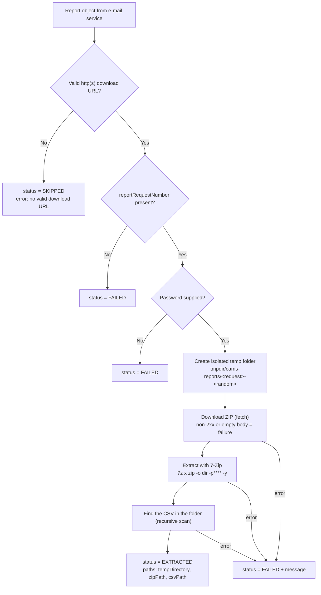

Key points:

- **One result per input report**; the array order matches the input, so identity is never lost when something fails.
- Each report gets its **own temp directory**; the request number is sanitised to `[A-Za-z0-9_-]` and a random suffix is appended.
- 7-Zip is run through `execFile` (no shell). If the executable cannot be found the error says to install 7-Zip or set
  `CAMS_7ZIP_PATH`. A wrong password or corrupt ZIP yields the generic message *"Failed to extract CAMS report. The ZIP may
  be corrupted or the password may be incorrect."* — the password and raw 7-Zip output are never exposed.
- The result object has the shape `{ identifiers: {...}, paths: { tempDirectory, zipPath, csvPath }, status, error }`.
- Temporary folders are **not deleted** by the application (see [14](#14-known-limitations-and-recommended-follow-ups)).

---

### 9.3 CAMS transactions pipeline

**Goal:** store every transaction line from CAMS "Investor Transactions for a Period" reports.
**Entry point:** `jobs/camsIngestionJob.js` → `services/cams_transactions/camsIngestionService.js#runCamsIngestion`.

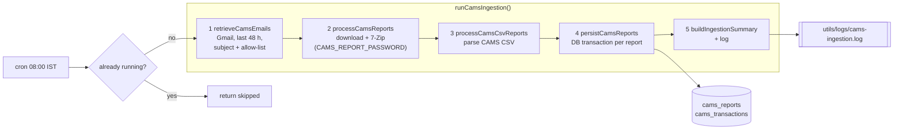

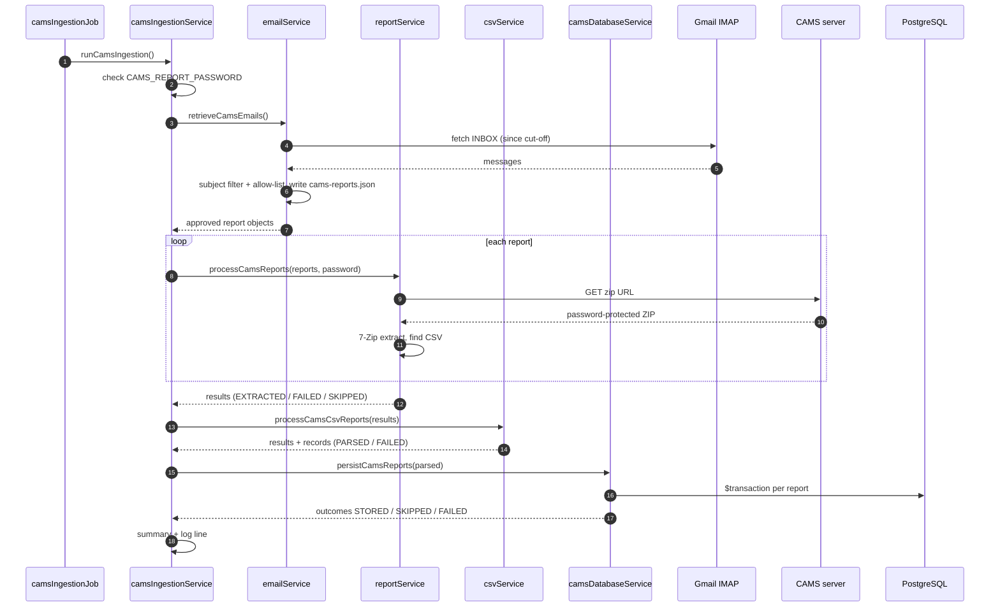

#### Stage 1 — E-mail retrieval (`services/cams_transactions/emailService.js`)

- Subject must match `/Investor\s+Transactions\s+for\s+a\s+Period/i`.
- Look-back is **48 hours** (the in-code comments still say 24).
- After parsing, only reports whose `reportRequestNumber` is in `APPROVED_REPORT_REQUEST_NUMBERS` (four numbers) are kept.
  This is a business allow-list so an unexpected report type cannot silently enter the database.
- The approved list is also written to `server/cams-reports.json` for audit/debugging (git-ignored).

#### Stage 2 — ZIP download and extraction

See [9.2.3](#923-zip-download-and-extraction-reportservicejs); password is `CAMS_REPORT_PASSWORD`.

#### Stage 3 — CSV parsing (`csvService.js`, `camsCsvParsingUtils.js`)

CAMS exports a non-standard CSV:

- fields are wrapped in **single quotes** (`'AMC_CODE','FOLIO_NO',…`), not double quotes;
- apostrophes inside a value are **not escaped** (e.g. `D'SOUZA`);
- the header row may be **missing** (the full ordered header list from `CAMS_TRANSACTION_FIELDS` is used as a fallback).

The parser therefore uses `'` as the quote character, runs the stream through a quote-normalising transform, rejects
malformed row shapes, and keeps **every value as a string**. Reports that did not reach `EXTRACTED` are passed through with
their original status and error and an empty `records` array. A parser failure never returns partial data.

#### Stage 4 — Persistence and idempotency (`camsDatabaseService.js`)

For each report, inside **one Prisma transaction**:

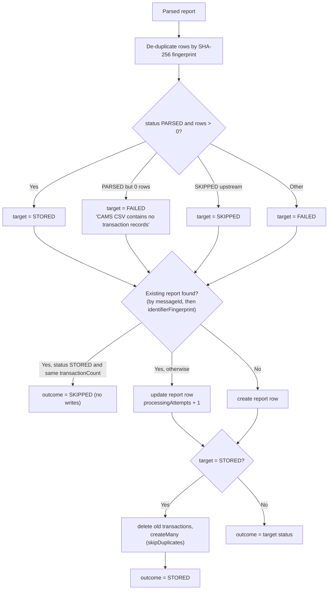

Why this is safe to re-run:

- A report is identified by `messageId` or by `identifierFingerprint` (SHA-256 of messageId, request number, report number,
  dispatch time, recipient).
- If the same report is stored again with an equal transaction count it is **skipped**; a different count means an earlier
  partial/incorrect parse, so the report's transactions are **rebuilt atomically**.
- Duplicate rows inside a report are dropped via the per-row fingerprint, and `(reportId, fingerprint)` is unique in the database.
- Because the look-back window overlaps successive runs, the same e-mail can be downloaded twice; the database layer makes
  that harmless.

#### Stage 5 — Summary and log

`buildIngestionSummary` returns e.g. `{ transactions: 452, STORED: 3, SKIPPED: 1 }`. A JSON line is appended to
`utils/logs/cams-ingestion.log`:

```json
{"timestamp":"2026-10-11T02:30:41.120Z","level":"info","message":"CAMS ingestion completed","elapsedMs":18342,"received":4,"transactions":452,"STORED":3,"SKIPPED":1}
```

Failures log `level: "error"` with the message and elapsed time, then re-throw to the job layer (which swallows it).

---

### 9.4 CAMS AUM (WBR22) pipeline

**Goal:** keep the company's AUM per fund current from CAMS' WBR22 reports.
**Entry point:** `jobs/wbr22AumIngestionJob.js` → `services/cams_wbr22_automation/wbr22AumIngestionService.js#runWbr22AumIngestion`.

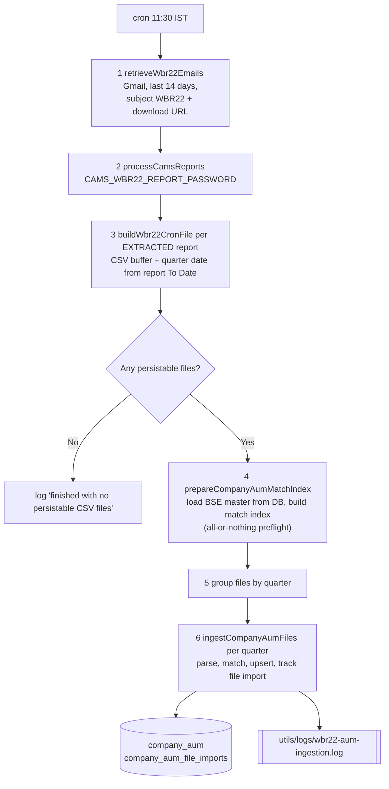

Step details:

1. **E-mails** — subject regex `WBR22.\s*AuM on a specific date by Scheme by Investor`; the e-mail must contain a valid
   download URL. Look-back defaults to **14 days**; this is safe because already imported files are skipped by hash.
   Report request numbers fall back to the request number, the Message-ID, or a timestamp if the e-mail has none.
   *Recipient filtering is switched off by design* (`ENFORCE_TARGET_RECIPIENT = false`): the reports are auto-forwarded from
   several mailboxes into the admin mailbox, so the visible `To:` is the original recipient, not the admin mailbox.
   The report-request-number allow-list in this file is defined but not applied.
2. **Extraction** — the shared `reportService`; password `CAMS_WBR22_REPORT_PASSWORD`.
3. **Cron-file build** — `wbr22CronFileUtils.buildWbr22CronFile` reads the CSV into memory and converts the report's CAMS
   *To Date* (`DD/MM/YYYY`) into an ISO date **using UTC arithmetic** (independent of the server's time zone). That date decides
   the financial year and quarter. A report with no CSV path or an invalid To Date becomes a *preparation failure* and does not
   stop the others.
4. **BSE preflight** — the scheme master is read from `bse_scheme_masters` (and auto-synchronised from BSE if that table is
   empty). This happens **before** any period or import row is created, so a failure here leaves no partial AUM writes.
5. **Persistence** — see [9.10](#910-how-company-aum-is-calculated) and [9.11](#911-fund-name-to-category-matching).

**WBR22 file format.** One row per client per scheme; only two columns matter, `SCHEME_NAME` and `CLOSING_ASSETS`.
CAMS wraps text in single quotes; a file may arrive **raw** (`'SCHEME_NAME','CLOSING_ASSETS'`) or **Excel-resaved**
(`SCHEME_NAME',CLOSING_ASSETS'`, leading apostrophe dropped). The tokenizer reads both identically. The parser
sums `CLOSING_ASSETS` per scheme and skips individual malformed numeric rows instead of aborting the file.

**Return value / log summary**

```json
{
  "received": 6,
  "extraction": { "EXTRACTED": 5, "FAILED": 1 },
  "preparationFailures": 0,
  "bseMasterSchemeCount": 12874,
  "persistedFiles": 5,
  "persistence": { "COMPLETED": 4, "SKIPPED_DUPLICATE": 1 },
  "periods": [ { "financialYear": "2026-27", "quarter": 3, "periodId": "0192fa00-…" } ]
}
```

---

### 9.5 Karvy transactions pipeline

**Goal:** store every line of KFintech "Transaction Feeds Report".
**Entry point:** `jobs/karvyTransactionIngestionJob.js` → `services/karvy_transactions/karvyIngestionService.js#runKarvyTransactionIngestion`.

It mirrors the CAMS transaction pipeline stage for stage:

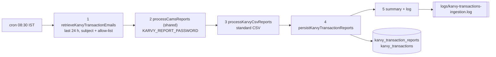

What differs from CAMS:

| Aspect | Karvy specifics |
|---|---|
| Subject | `/Transaction\s+Feeds\s+Report/i` (the word *Feeds* is required so the shorter, unrelated "Transaction Report" mails are ignored) |
| Identifier | `Ref. No. : WBTRN…` taken from the **subject** (punctuation varies, and a `Fwd:` prefix is tolerated) |
| Allow-list | Four `WBTRN…` reference numbers (`APPROVED_KARVY_TRANSACTION_REPORT_REQUEST_NUMBERS`) |
| Download link | HTML "Click Here" anchor → obfuscated `scdelivery.kfintech.com` URL, decoded in `karvyEmailParsingUtils` |
| Look-back | 24 hours |
| CSV | Clean, standard comma-separated file with a header (about 90 columns); parsed with a normal `csv-parse` configuration — no custom quote handling |
| Tables | Separate `karvy_transaction_reports` / `karvy_transactions` |
| Persistence | Identical algorithm to CAMS (fingerprints, skip when equal count, atomic rebuild otherwise) |
| Log | `server/logs/karvy-transactions-ingestion.log` (note: different folder from the CAMS log) |

---

### 9.6 Karvy AUM pipeline

**Goal:** add KFintech-serviced funds to the same per-fund company AUM rows used for CAMS, so the company has **one combined
picture** regardless of which RTA services a fund.
**Entry point:** `jobs/karvyWbr22AumIngestionJob.js` → `services/karvy_wbr22_automation/karvyWbr22AumIngestionService.js#runKarvyWbr22AumIngestion`.

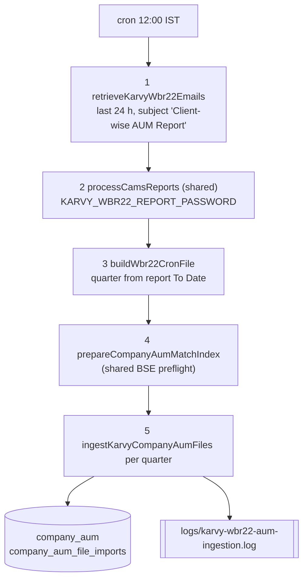

| Aspect | Karvy AUM specifics |
|---|---|
| Subject | `/Client-?\s*wise\s+AUM\s+Report/i` — covers both `Client-wise AUM Report for Ref.no. WBCUM…` (auto-forward) and `Fwd: Subscribed ClientWise AUM Report for Ref. No. : WBCUM…` (manual forward) |
| Allow-list | One `WBCUM…` reference number is defined but **not applied** — every matching subject is processed |
| Look-back | 1 day |
| CSV columns | `Fund Description` (scheme name) and `AUM` (value) — standard CSV, so parsed with `csv-parse` (`columns: true`) |
| Persistence | `karvyCompanyAumIngestionService.js` is intentionally a near-copy of the CAMS persistence; **only the parser differs**. Matching, category resolver and the daily upsert are imported unchanged from the CAMS side |
| Result | Same summary shape as CAMS AUM |

---

### 9.7 BSE StAR scheme master job

**Goal:** keep a local copy of BSE's scheme master so company funds can be mapped to a **category** (`scheme_type`) and an
**AMC** (`amc_code`).
**Entry point:** `jobs/bseStarSchemeMasterIngestionJob.js` → `services/bse_star_master/bseStarSchemeMasterIngestionService.js#syncBseSchemeMasterData`.

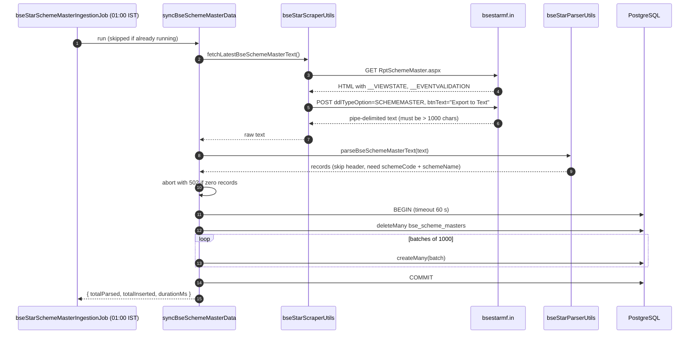

Details:

- The BSE page is an ASP.NET WebForms page. The scraper sends a browser-like `User-Agent`, reads the hidden
  `__VIEWSTATE`, `__VIEWSTATEGENERATOR` and `__EVENTVALIDATION` fields, then POSTs the form to export the master as text.
  It fails with a `502` if the tokens cannot be found, the request fails, or the response is smaller than 1000 characters.
- The file is **pipe-delimited**; line 0 is a header and is ignored. Columns are read **by position** (43 columns, see
  `HEADER_INDEX_MAP`); rows with fewer than 9 fields, or without `schemeCode` (index 1) or `schemeName` (index 8), are skipped.
  Empty values become `null`.
- The table is **replaced as a whole** in a single transaction, so readers never see a half-loaded table. Parsing
  happens *before* the delete, and zero parsed rows aborts the sync, so a bad download cannot wipe the table.
- **Auto-bootstrap:** if the AUM pipelines (or the manual import) find `bse_scheme_masters` empty, they call this sync once
  themselves before continuing.
- No BSE credentials are used here — the page is public.

> `BSE_STARMF_USERNAME` / `BSE_STARMF_PASSWORD` and `utils/cams_wbr22/bseStarmfAuthenticationUtils.js` belong to an earlier
> approach (login to a BSE StAR MF API and fetch `master_scheme_list`). The helper code is still present but **no pipeline
> calls it any more**.

---

### 9.8 AMFI industry AUM job

**Goal:** store AMFI's quarterly **industry** AUM/AAUM by category, to compare the company against the market.
**Entry point:** `jobs/amfiIngestionJob.js` → `services/industry_aum/amfiIngestionService.js#runAmfiIngestion`.
**Schedule:** 08:00 IST on the 1st of every month. AMFI does not publish quarters on a predictable day, so a cheap monthly
check is used instead of "every four months"; quarters already `COMPLETED` are skipped almost instantly, and a late
publication is picked up automatically.

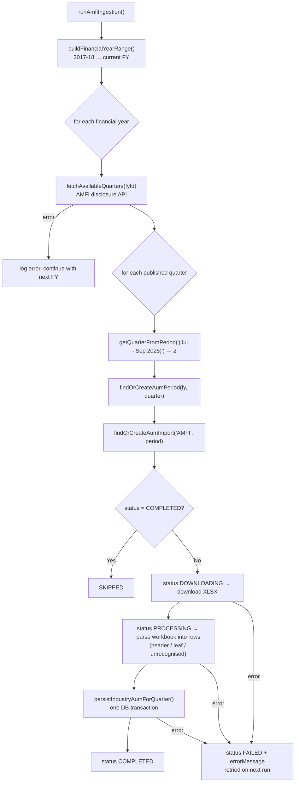

Details:

1. **Financial years.** The range starts at `AMFI_FIRST_FINANCIAL_YEAR = "2017-18"` and ends at the current financial year.
2. **Quarter list.** `GET https://www.amfiindia.com/api/get-disclosure-category?fyId=<FY>` returns
   `QuarterlyDisclosureAUMbyCategorywise[0].data`, an array of `{ Period, pdfURL, excelURL }`. A year with no data (for example
   one that has not started publishing) raises an error that is logged; processing continues with the other years.
3. **Quarter number.** Taken from the period label by its starting month: `Apr → 1`, `Jul → 2`, `Oct → 3`, `Jan → 4`
   (pattern like `(Jul - Sep 2025)`). Unrecognised labels are skipped and counted as failed.
4. **Tracking.** `aum_imports` has one row per `(source = AMFI, period)`. Its **status is the only source of truth** for
   "already done"; the job never re-inspects `industry_aum` itself to decide.
5. **Workbook parsing** (`amfiXlsxParsingUtils.js`). Only the first sheet is read, **by position** because titles and headers
   change every quarter. Each row is `[marker, name, aum, aaum, …]`:

   | Row looks like | Classified as |
   |---|---|
   | name present, **two numeric** values | **leaf** (a real category with AUM and AAUM) |
   | name present, no numbers, marker `A`/`B`/`C` | header level 1 |
   | name present, no numbers, marker roman numeral (`I`, `II`, `IV`…) | header level 2 |
   | name present, no numbers, marker like `a)` | header level 3 |
   | name present but no recognisable marker/values | unrecognised (logged, skipped) |
   | blank name, a `Total` row, or text in a numeric cell | discarded |

6. **Persisting** (`industryAumService.js`). Rows are walked in order while maintaining a stack of the currently open
   headers; each leaf attaches to the deepest open header. The `aumCategoryResolver` finds the category by **(parent, name)**
   and creates unseen ones with correct `parentId`, `level` and `isLeaf`. All leaves of one quarter are saved in **one
   transaction**, so a quarter is complete or absent.
7. **Failure handling.** A failed quarter is marked `FAILED` with its error message and retried next month; one bad quarter
   never stops the others.

Console and log summary:

```text
Financial years checked : 9
Quarters completed      : 1
Quarters skipped        : 34
Quarters failed         : 0
Elapsed                 : 41.2s
```

---

### 9.9 Date-label job

**File:** `jobs/dateStatusJob.js` · **Schedule:** daily 08:00 IST · **No external systems.**

Tasks and leads store a human-friendly label (`dueDateLabel`, `follow_up_label`) so the UI does not recompute it for every row.
Each morning the job:

1. loads all tasks whose label is not `Expired` and updates each with `getDateLabel(dueDate)`;
2. does the same for leads using `follow_up_date`;
3. logs `Daily date status update completed` (or `Date status cron failed` plus the message).

Rows already `Expired` are never revisited because a past date can never become current again.

`getDateLabel` (in `utils/date_processor.js`) ignores the time part and compares calendar days in the server's local time:

| Date compared with today | Label |
|---|---|
| before today | `Expired` |
| today | `Today` |
| tomorrow | `Tomorrow` |
| later | `DD Mon`, formatted with the `en-IN` locale (e.g. `05 Mar`) |

New records start with the label `Upcoming` until the next run.

---

### 9.10 How company AUM is calculated

Both AUM pipelines and the manual import call the same function, `upsertDailyCompanyAum`
(`utils/cams_wbr22/companyAumUpsertUtils.js`), for **every fund in every file**. `company_aum` holds **one row per
(fund, quarter)**, identified by `(period_id, scheme_name)`, and is kept continuously current as daily files arrive.

Meaning of the columns:

| Column | Meaning |
|---|---|
| `aum` | The fund's **latest daily total** (sum of the day's files across clients) |
| `aaum` | The **running average of the daily totals** recorded so far in the quarter |
| `days_recorded` | How many distinct days have been folded into `aaum` |
| `last_updated_date` | The calendar day (UTC, date only) the row was last updated — the day the file was *processed* |

Three cases are decided by comparing today with `last_updated_date`:

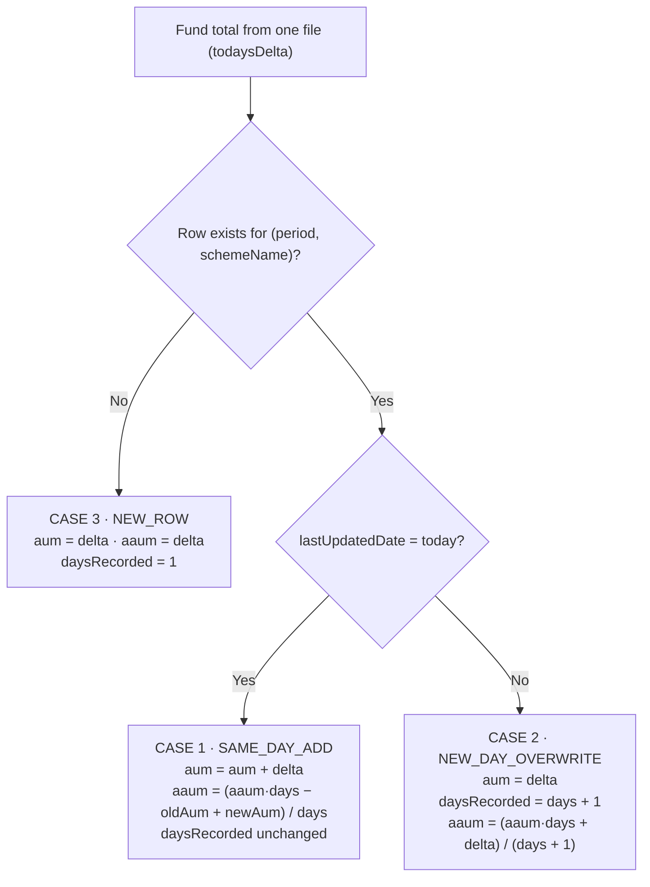

| Case | Trigger | Why |
|---|---|---|
| `NEW_ROW` | No row for this fund in this quarter. A **new quarter** naturally lands here because the period id differs. | First sighting. The previous quarter's row is never touched again — it stays as permanent history. |
| `SAME_DAY_ADD` | Another file for a fund already updated **today** | CAMS sends up to four files a day and Karvy sends its own; each covers different, non-overlapping clients, so same-day figures are **additive**. |
| `NEW_DAY_OVERWRITE` | File for a fund last updated on an **earlier day** of the same quarter | Each day's file is a fresh, complete snapshot, so it **replaces** the previous value; only the average accumulates. |

**Worked example** — one fund, one quarter:

| Event | File value | Case | `aum` | `daysRecorded` | `aaum` |
|---|---|---|---|---|---|
| Day 1, file A | 100 | NEW_ROW | 100 | 1 | 100 |
| Day 1, file B | 50 | SAME_DAY_ADD | 150 | 1 | 150 |
| Day 2, file A | 160 | NEW_DAY_OVERWRITE | 160 | 2 | (150 + 160) / 2 = 155 |
| Day 2, file B | 40 | SAME_DAY_ADD | 200 | 2 | (150 + 200) / 2 = 175 |
| Day 3, file A | 210 | NEW_DAY_OVERWRITE | 210 | 3 | (150 + 200 + 210) / 3 = 186.67 |

Safeguards around the calculation:

- **File-level de-duplication:** every file's SHA-256 is stored in `company_aum_file_imports`
  (unique per quarter). A byte-identical file already `COMPLETED` is skipped (`SKIPPED_DUPLICATE`) — this is what makes the
  14-day CAMS look-back and accidental re-uploads safe. A file that previously `FAILED` is retried.
- **Atomicity:** all fund updates of one file are applied in one database transaction.
- **Isolation:** a bad file produces a `FAILED` result for that file only; the rest of the batch continues.
- **Fresh classification:** `categoryId` and `amcCode` are refreshed on every update in case the BSE master changes.
- **Combined RTAs:** CAMS- and KFintech-sourced data land in the **same** rows, because rows are keyed by the matched fund name.

### 9.11 Fund-name to category matching

WBR22 files say *how much* is in a fund but not *which category* it belongs to; the BSE master says the category but spells
names differently. `schemeNameMatchingUtils.js` bridges the two.

1. **Normalise** both sides identically: upper-case → remove text in parentheses → `&` becomes `AND` → strip punctuation →
   drop noise words (`REGULAR, DIRECT, PLAN, GROWTH, IDCW, DIVIDEND, PAYOUT, REINVESTMENT, REINVEST, BONUS, OPTION, SCHEME`).
   Different plans/options of one fund therefore collapse into one name.
2. **Index once per batch:** an exact-match map (normalised name → `{ category, amcCode }`, first entry wins) and a "block"
   index that buckets candidates by their **first word** (almost always the AMC name), so fuzzy matching scans a short list.
3. **Match** — exact lookup first; otherwise score every candidate in the same first-word bucket with the
   **Ratcliff/Obershelp** ratio (`sequenceMatcher.js`, a dependency-free version of Python's `difflib.SequenceMatcher.ratio`).
   The best candidate is accepted only if its score is **≥ 0.90**.
4. **Result.**

   | Outcome | Category used | Stored `scheme_name` |
   |---|---|---|
   | exact or fuzzy match | master `scheme_type` (upper-cased, e.g. `EQUITY`, `DEBT`, `LIQUID`) | the matched normalised master name |
   | no match | `Other` | the normalised WBR22 name (or the raw trimmed text if normalisation empties it) |

   Unmatched funds are reported back with their best guess and score (`bestGuessMatch`, `bestGuessScore`) so an admin can
   investigate. Normalising the fallback name keeps tiny formatting differences between days from creating duplicate rows.
5. **Categories** used for company data are **flat** (level 1, leaf, no parent) and created on first use by the category
   resolver, inside the same transaction as the upsert.

The threshold is deliberately strict: only the *category* has to be right, and a close same-AMC near-duplicate normally
shares the category, but a wrong guess would mis-attribute money, so the system prefers "unmatched → `Other` and flag it".

---

## 10. Logging and Observability

There is no central logging framework. Two mechanisms are used:

1. **`console.log` / `console.error`** — progress lines such as `[CompanyAUM] FY 2026-27 Q2: processing "file.csv"...`, `[AMFI] …`,
   `[BseSchemeMaster] …`. These go to the process's standard output; capture them with your process manager.
2. **Structured JSON log files** — one JSON object per line (`timestamp`, `level`, `message`, plus counts and timings) written
   by small logger helpers. They only contain sanitised outcomes, counts, durations and error messages — never passwords or
   mailbox credentials.

| Log file | Written by | Folder (relative to `server/`) |
|---|---|---|
| `cams-ingestion.log` | CAMS transactions | `utils/logs/` |
| `wbr22-aum-ingestion.log` | CAMS AUM | `utils/logs/` |
| `amfi-ingestion.log` | AMFI industry AUM | `utils/logs/` |
| `karvy-transactions-ingestion.log` | Karvy transactions | `logs/` |
| `karvy-wbr22-aum-ingestion.log` | Karvy AUM | `logs/` |

> The CAMS, WBR22 and AMFI loggers resolve their folder as `utils/logs`, while the two Karvy loggers resolve to `server/logs`.
> Both folders are git-ignored and are created automatically on first write. There is no log rotation.
> The BSE master job and the date-label job log to the console only.

**Quick health checks**

```bash
# last outcome of each pipeline (PowerShell: Get-Content <file> -Tail 1)
tail -n 1 server/utils/logs/cams-ingestion.log
tail -n 1 server/logs/karvy-transactions-ingestion.log
```

```sql
-- Which report e-mails failed or were skipped recently?
SELECT "reportRequestNumber", status, error, "processingAttempts", "updatedAt"
FROM cams_reports
WHERE status <> 'STORED'
ORDER BY "updatedAt" DESC LIMIT 20;

-- Company AUM for the current quarter, biggest funds first
SELECT scheme_name, amc_code, aum, aaum, days_recorded, last_updated_date
FROM company_aum
ORDER BY aum DESC LIMIT 20;

-- Files imported and how well they matched
SELECT file_name, status, matched_scheme_count, unmatched_scheme_count, completed_at
FROM company_aum_file_imports
ORDER BY created_at DESC LIMIT 20;
```

---

## 11. Manual Runs and Testing

The repository has **no automated test suite** (`npm test` is the default placeholder). Verification is done with manual
runner scripts in `server/temp/` (git-ignored, present on developer machines). Each one calls the same service function as
the cron job but **without** registering a schedule.

| Script | Runs | Notes |
|---|---|---|
| `node temp/runCamsIngestionTest.js` | CAMS transactions | Prints the summary or the error; exit code 1 on failure |
| `node temp/runKarvyTransactionIngestionTest.js` | Karvy transactions | |
| `node temp/runWbr22AumIngestionTest.js` | CAMS AUM | Honours `TEST_LOOKBACK_DAYS` |
| `node temp/runKarvyWbr22AumIngestionTest.js` | Karvy AUM | Honours `TEST_LOOKBACK_DAYS` |
| `node temp/runAmfiIngestionTest.js` | AMFI industry AUM | Walks all years — takes a while on first run |
| `node temp/runAllPipelines.js` | BSE master sync → CAMS AUM → Karvy AUM | Handy for first-time population |

Run these from the `server/` folder so `.env` and relative paths resolve.

You can also trigger any job from the Node REPL because each job file exports its runner:

```js
// node
require('dotenv').config();
require('./services/bse_star_master/bseStarSchemeMasterIngestionService').syncBseSchemeMasterData().then(console.log);
```

> Requiring a **job** file (as opposed to a service file) registers its cron schedule as a side effect — use the service
> modules for one-off runs.

**Suggested recovery recipes**

| Situation | What to do |
|---|---|
| A morning transaction run failed (e.g. mailbox down) | Fix the cause and run the matching `temp/run…Test.js`. Re-runs are idempotent. |
| AUM e-mails missed for several days | Run `runWbr22AumIngestionTest.js` with a larger `TEST_LOOKBACK_DAYS`. See the caveat about day semantics in [14](#14-known-limitations-and-recommended-follow-ups). |
| A WBR22 file must be loaded by hand | `POST /api/company-aum/import` with `quarterDate` and the CAMS file(s). |
| BSE master looks stale or empty | Run the BSE sync once; it fully replaces the table. |
| New AMFI quarter published early | Run `runAmfiIngestionTest.js`; completed quarters are skipped. |

---

## 12. Security Notes

This section describes how the system behaves **today** and what to harden before wider exposure. It is documentation of
current behaviour, not a statement that the items are acceptable for production.

| # | Area | Current behaviour | Recommendation |
|---|---|---|---|
| 1 | Session storage | Default in-memory store. Sessions vanish on restart and cannot be shared by several instances. `connect-pg-simple` is installed but not wired in. | Use a persistent store (e.g. PostgreSQL via `connect-pg-simple`) before running more than one instance. |
| 2 | Cookie flags | `secure: false`. `httpOnly` and `sameSite: lax` are set; lifetime 24 h. | Set `secure: true` and `app.set('trust proxy', 1)` behind HTTPS. |
| 3 | `SECRET` | Signs cookies and sessions. | Long random value per environment; rotate if leaked. |
| 4 | Sign-up | `POST /api/auth/signup` is public and accepts `role` from the client. No endpoint checks roles. | Restrict sign-up to admins or invite-only; enforce roles server-side. |
| 5 | User listing | `getUsers` / `getUser/:id` return stored user objects including the **bcrypt hash**, to any logged-in user. | Select only safe fields (`id`, `name`, `email`, `role`…); restrict to admins. |
| 6 | Uploads | For leads, `multer` runs **before** `isAuthenticated`, so an unauthenticated request can write a file to `uploads/`. Files keep their original names (collisions overwrite). | Authenticate first, generate unique file names, restrict type/size. |
| 7 | Brute force | No rate limiting or lockout on `/login`; login reveals whether an e-mail exists. | Add rate limiting; return one generic message. |
| 8 | Input validation | Sign-up does not validate e-mail format or password strength. | Tighten the Joi schemas. |
| 9 | ZIP passwords | Passed to 7-Zip on the command line (`-p<password>`), which a local user may see in the process list during extraction. | Acceptable on a dedicated host; otherwise use an extraction method that does not expose arguments. |
| 10 | Decrypted data on disk | ZIPs and decrypted CSVs (client PAN, folio, holdings) are left in `<tmpdir>/cams-reports/…` after each run. | Delete the workspace after processing; restrict OS permissions. |
| 11 | Personal data | PAN, folio numbers, names, e-mail and mobile are stored as plain text columns. | Apply DB-level access control, encryption at rest and a retention policy. |
| 12 | Secrets in source | The WBR22 e-mail service contains personal e-mail addresses in a constant and comments. | Move to configuration or remove. |
| 13 | CORS | Single hard-coded origin `http://localhost:5173`. | Make the allowed origins configurable per environment. |
| 14 | Download hosts | CAMS links are restricted to `mailbackN.camsonline.com`. KFintech links are decoded from the e-mail and validated to be KFintech URLs; the generic downloader accepts any http(s) URL it is handed. | Keep the host checks in the e-mail parsers; consider an allow-list inside the downloader too. |
| 15 | HTTP hardening | No `helmet`, no request-size limits beyond Express defaults. | Add standard hardening middleware. |

What is already done well: passwords are hashed with bcrypt (cost 12) and stripped from login/sign-up responses; the record
owner always comes from the session (never from the body); tasks and leads are ownership-checked on every read, update and
delete; secrets are read from the environment and never written to logs; ZIP extraction does not use a shell; CAMS download
links are host-restricted.

---

## 13. Troubleshooting and FAQ

| Symptom | Likely cause | Fix |
|---|---|---|
| `Cannot find module '@prisma/client'` or *"@prisma/client did not initialize yet"* | Client not generated | `npx prisma generate` |
| `PrismaClientInitializationError` / cannot connect | Wrong or missing `DATABASE_URL` | Check `server/.env`; confirm PostgreSQL is running and reachable |
| `relation "bse_scheme_masters" does not exist` or `column "arn_no" does not exist` | The migration drift described in [7.7](#77-migrations-history) | Generate and apply the missing migration |
| `CAMS_REPORT_PASSWORD is not configured` (or the Karvy/WBR22 equivalent) | Variable missing in `.env` | Add it; restart the server |
| `No supported archive extractor was found. Install 7-Zip or set CAMS_7ZIP_PATH.` | 7-Zip not installed or not in a default Windows path | Install 7-Zip ([4.2](#42-installing-7-zip)) or set `CAMS_7ZIP_PATH` |
| `Failed to extract CAMS report. The ZIP may be corrupted or the password may be incorrect.` | Wrong ZIP password for that report type, or truncated download | Check the matching `*_REPORT_PASSWORD`; each pipeline has its own |
| IMAP error such as *Invalid credentials* / `AUTHENTICATIONFAILED` | Normal Gmail password used, IMAP disabled, or no app password | Enable IMAP, use an **app password** in `GMAIL_IMAP_PASSWORD` |
| Job runs but `received: 0` | No matching mail in the look-back window, subject changed, or (transactions) a **new report request number** not on the allow-list | Check the mailbox; update the subject regex or allow-list in code |
| `CAMS report does not contain a valid download URL` (status `SKIPPED`) | The link could not be extracted from the e-mail | Inspect `cams-reports.json` / the raw e-mail; for Karvy check the HTML "Click Here" anchor |
| `WBR22 file is missing the required SCHEME_NAME/CLOSING_ASSETS columns` | A non-CAMS file was uploaded to the manual import, or the file layout changed | Use a CAMS WBR22 file (Karvy files go through the Karvy job) |
| Many funds land in category `Other` | The scheme is missing from the BSE master, or its name differs by more than the 0.90 threshold | Look at `unmatchedSchemes` in the import result; refresh the BSE master; consider adjusting matching |
| `BSE Star MF returned empty or unexpectedly small scheme master export file` / `Failed to parse ASP.NET viewstate…` | BSE page changed or temporarily unavailable | Retry later; if persistent, update `bseStarScraperUtils.js` |
| `AMFI disclosure API returned no data for FY …` | A financial year with no published data (normal for a future/early year) | Informational; other years continue |
| Login works but the next request is `401` | Cookie not sent (browser must use `credentials: 'include'`), origin not allowed by CORS, or the server restarted (in-memory sessions) | Check the UI origin and cookie; log in again |
| `Unique constraint failed on the fields: (email)` when creating a lead | Duplicate `email`, `mobile` or `pan` (unique across all users) | Use different values or look up the existing lead |
| `[JobName] … already-running` / `{ skipped: true }` | A previous run is still in progress | Wait; investigate a hung run if it persists |
| Uploaded lead file not found | `uploads/` is relative to the process working directory | Always start the server from `server/` |

**FAQ**

*Do I need Gmail and 7-Zip to develop the CRM/API?* No. They are needed only by the four e-mail-driven pipelines.

*Can the same report be processed twice?* Yes, harmlessly. Transaction reports are de-duplicated by report and row
fingerprints; AUM files by SHA-256 per quarter.

*Why are there two near-identical company-AUM services?* The Karvy variant was copied so the already-working CAMS code
stayed untouched; only the parser differs. They share the matcher, resolver and upsert logic.

*Why are all transaction fields strings?* The RTAs' formats are inconsistent (dates, numbers, flags). Storing the values
verbatim preserves what the RTA sent; conversion is left to downstream queries.

*Why do two jobs run at 08:00?* The CAMS transactions job and the date-label job do not share any resource (one uses the
mailbox, the other only the database).

*Where does the category in analytics come from?* From the BSE master's `scheme_type` (company data) — the same data
that decides `Other` for unmatched funds.

*Is the industry (AMFI) data exposed by an API?* Not yet. It is collected into `industry_aum` for future comparison endpoints;
the analytics endpoints currently read `company_aum` only.

---

## 14. Known Limitations and Recommended Follow-ups

Items are ordered by importance. "Doc/code mismatch" entries mean a source-file comment says something different from what
the code does; **this README describes the code's behaviour**.

### 14.1 Needs attention before handing over

| # | Item | Impact | Suggested action |
|---|---|---|---|
| 1 | **Schema/migration drift** — `bse_scheme_masters` and `company_aum_file_imports.arn_no/report_from_date/report_to_date` are in `schema.prisma` but in no migration | A database built from migrations alone breaks the BSE job and company-AUM imports | Create and commit a migration (see [7.7](#77-migrations-history)) and test a clean install |
| 2 | **Password hashes returned** by `getUsers` / `getUser/:id` | Sensitive data exposure | Restrict returned fields |
| 3 | **Upload before auth** on lead create/update | Unauthenticated file writes | Reorder middleware: authenticate first |
| 4 | **Open sign-up with client-chosen role** and no role checks | Anyone can create an "admin" account | Gate sign-up; enforce roles |
| 5 | **AUM day semantics** (below) | Backlogs can inflate AUM/AAUM | Decide the intended behaviour and encode it |

**AUM day semantics.** `last_updated_date` is the day a file is **processed**, not the date inside the report. If several
days' files are processed in one run — after downtime, or with the 14-day CAMS look-back after a failed week — they are all
treated as "today" and **added together** (`SAME_DAY_ADD`) instead of overwriting each other, which overstates `aum` and skews
`aaum`. The same applies to a *corrected re-send* of the same day's report (different bytes, so not a duplicate). If
back-fills are expected, process one report day at a time or change the upsert to use the report's own date.

### 14.2 Functional gaps

| # | Item | Notes |
|---|---|---|
| 6 | `periodId` and `limit` are validated but ignored by the analytics controllers | Analytics always use the latest quarter with data |
| 7 | Industry AUM is stored but not exposed by any endpoint | No industry-versus-company comparison API yet |
| 8 | Manual import supports the CAMS WBR22 layout only | KFintech files are handled by the cron job |
| 9 | No "company agent" or client entities exist; `clientId` is a plain string on tasks and leads | Placeholder until a `Client` model is added |
| 10 | Task `description` is optional in the validator but required in the database | Omitting it causes a 500; send `""` |
| 11 | Lead uniqueness violations return 500 | A 409 with a friendly message would be clearer |
| 12 | Authentication failures use status 404 (and "already exists" uses 404) | `401`/`409` would be conventional; clients currently depend on the existing codes |
| 13 | Report request-number allow-lists are hard-coded | New report numbers are ignored until code changes; consider configuration |
| 14 | Karvy AUM and CAMS AUM e-mail services do not apply their allow-lists | Intentional today (subject + link only); the constants are kept for re-enabling |

### 14.3 Operational and quality gaps

| # | Item | Notes |
|---|---|---|
| 15 | No automated tests, linting or CI; `npm test` is a placeholder; there is no `start` script | Verification is by manual runners in `temp/` |
| 16 | In-memory sessions; per-process overlap guards | Single-instance deployment only, as is |
| 17 | Temporary report folders (ZIP + decrypted CSV) are never deleted | Disk growth and data-at-rest exposure |
| 18 | Job failures are only logged (no alerting); log files do not rotate; log folders differ (`utils/logs` vs `logs`) | Add monitoring and rotation |
| 19 | 7-Zip lookup is Windows-first and the variable is named `CAMS_7ZIP_PATH` for all pipelines | Works elsewhere when the path is set |
| 20 | Unused dependencies: `googleapis`, `@google-cloud/local-auth`, `connect-pg-simple` | Remove or use |
| 21 | Unused code: `bseStarmfAuthenticationUtils.js`, `fetchMasterSchemeList(token)`, and the `BSE_STARMF_*` variables | Leftover from the earlier BSE API approach |
| 22 | `dateStatusJob` updates rows one by one and assigns an undeclared loop variable (`for (lead of leads)`) | Works, but prefer `const` and batched updates |
| 23 | Duplicate company-AUM persistence code (CAMS and Karvy) | Candidate for one parameterised service |
| 24 | Table-rename migrations drop and re-create tables | Review before applying to a database that already holds data |

### 14.4 Doc/code mismatches found in source comments

| Where | Comment says | Code does |
|---|---|---|
| `services/cams_transactions/emailService.js` (and the orchestrator) | "last 24 hours" | 48-hour window |
| `services/cams_wbr22_automation/wbr22EmailService.js` header | "received in the last 24 hours" | 14-day default look-back |
| `services/industry_aum/amfiIngestionService.js`, `amfiApiUtils.js` examples | years start at 2011-12 | `AMFI_FIRST_FINANCIAL_YEAR = "2017-18"` |
| `services/karvy_wbr22_automation/karvyWbr22EmailService.js` | "enforce the report request-number allow-list" | allow-list is defined but not applied |
| AUM orchestrators | "BSE login/master-list preflight" | preflight loads the master from the database (auto-sync from the public BSE page); no BSE login |
| `index.js` header | "three route groups (auth, tasks, leads)" | five routers (plus `company-aum` and `analytics`) |
| `utils/industry_aum/amfiJobLogger.js` | `logs/amfi-ingestion.log` | written to `utils/logs/amfi-ingestion.log` |

---

## 15. Deployment Checklist

| # | Step | Done when |
|---|---|---|
| 1 | Provision Node.js 20+, PostgreSQL and **7-Zip** on the host | `node -v`, `psql --version`, 7-Zip path known |
| 2 | Clone the repository and run `npm install` in `server/` | `node_modules` present |
| 3 | Create `server/.env` from [5.2](#52-example-env) with production values (strong `SECRET`, app password, ZIP passwords, `CAMS_7ZIP_PATH` on non-Windows) | Server starts without "not configured" errors |
| 4 | Resolve the migration drift ([7.7](#77-migrations-history)) | A clean database reaches the full schema via `migrate deploy` |
| 5 | `npx prisma generate` then `npx prisma migrate deploy` | All migrations applied |
| 6 | `node prisma/seed/seedAumCategories.js` | `aum_categories` populated |
| 7 | Set the production CORS origin, `secure` cookies and a persistent session store ([12](#12-security-notes)) | Login works over HTTPS and survives a restart |
| 8 | Start with a process manager (PM2, systemd, a Windows service) and set the working directory to `server/` | Auto-restart on crash; `uploads/` and `logs/` land in `server/` |
| 9 | Run the BSE sync once, then `runAllPipelines.js` and a transaction runner | `bse_scheme_masters` filled; log files show `completed` |
| 10 | Make sure the mailbox auto-forwards/receives the CAMS and KFintech reports and that the allow-listed request numbers are current | A dry run shows `received > 0` |
| 11 | Schedule log rotation and temp-folder cleanup; set up monitoring on the log files | Alerts on `"level":"error"` |
| 12 | Back up the database and verify restore | Documented procedure |

Run **exactly one** server instance per mailbox/database (see [4.6](#46-running-the-server)).

---

## 16. Appendix

### 16.1 Request-flow cheat sheet

```text
Browser ──► CORS ──► session ──► route ──► [multer] ──► isAuthenticated ──► Joi validate ──► wrapAsync(controller)
                                                                                                │
                                                                         Prisma ◄───────────────┘
                                                                            │
                                         JSON response ◄────────────────────┘      errors ─► central handler
```

### 16.2 Pipeline cheat sheet

```text
E-mail pipelines:  Gmail ─► filter(subject[, allow-list]) ─► extract link ─► download ZIP ─► 7-Zip ─► CSV ─► parse ─► DB
Transactions:      parse ─► fingerprint rows ─► atomic per-report store (skip / rebuild)
Company AUM:       parse ─► sum per fund ─► match to BSE master ─► daily upsert (NEW_ROW | SAME_DAY_ADD | NEW_DAY_OVERWRITE)
BSE master:        scrape page ─► parse pipe-delimited text ─► replace table
AMFI:              API list ─► XLSX ─► classify rows ─► resolve categories ─► industry_aum (per quarter, one transaction)
```

### 16.3 Status vocabularies

| Where | Values |
|---|---|
| Report extraction (in memory) | `EXTRACTED`, `FAILED`, `SKIPPED` |
| CSV parsing (in memory) | `PARSED`, `FAILED`, passed-through upstream status |
| `cams_reports.status`, `karvy_transaction_reports.status` | `RECEIVED`, `PARSED`, `STORED`, `SKIPPED`, `FAILED` |
| Persistence outcome | `STORED`, `SKIPPED`, `FAILED` |
| `aum_imports.status`, `company_aum_file_imports.status` | `PENDING`, `DOWNLOADING`, `PROCESSING`, `COMPLETED`, `FAILED` |
| Company-AUM file result | `COMPLETED`, `SKIPPED_DUPLICATE`, `FAILED` |
| Upsert case | `NEW_ROW`, `SAME_DAY_ADD`, `NEW_DAY_OVERWRITE` |
| Job guard | `{ skipped: true, reason: "already-running" }` |

### 16.4 Quarter and date conventions

| Quarter | Months | Period start → end (FY `2026-27`) |
|---|---|---|
| Q1 | Apr – Jun | 2026-04-01 → 2026-06-30 |
| Q2 | Jul – Sep | 2026-07-01 → 2026-09-30 |
| Q3 | Oct – Dec | 2026-10-01 → 2026-12-31 |
| Q4 | Jan – Mar | 2027-01-01 → 2027-03-31 |

Quarter resolution uses **UTC** date parts. RTA dates are printed `DD/MM/YYYY` and converted with UTC arithmetic.

### 16.5 Quick command reference

```bash
npm install                                   # install packages
npx prisma generate                           # build Prisma client
npx prisma migrate deploy                     # apply migrations
node prisma/seed/seedAumCategories.js         # seed AMFI categories
node index.js                                 # start API + schedulers
node temp/runAllPipelines.js                  # BSE master + CAMS AUM + Karvy AUM, once
node temp/runCamsIngestionTest.js             # CAMS transactions, once
node temp/runKarvyTransactionIngestionTest.js # Karvy transactions, once
node temp/runAmfiIngestionTest.js             # AMFI industry AUM, once
```

### 16.6 Maintenance guide — "where do I change X?"

| I want to… | Edit |
|---|---|
| Change a job's time | the `cron.schedule(...)` line in the matching `jobs/*.js` |
| Approve a new CAMS report request number | `APPROVED_REPORT_REQUEST_NUMBERS` in `services/cams_transactions/emailService.js` |
| Approve a new Karvy transaction reference | `APPROVED_KARVY_TRANSACTION_REPORT_REQUEST_NUMBERS` in `services/karvy_transactions/emailService.js` |
| Change how far back a pipeline looks | the look-back constant/default in the matching email or orchestrator service ([5.3](#53-settings-that-live-in-code)) |
| Handle a changed e-mail subject | the subject regex in the matching e-mail service |
| Tune fund-name matching | `FUZZY_MATCH_THRESHOLD` / `NOISE_WORDS` in `schemeNameMatchingUtils.js` |
| Add a column to CAMS transactions | `CAMS_TRANSACTION_FIELDS` (+ the Prisma model and a migration) |
| Add a column to Karvy transactions | `karvyTransactionPersistence.js` mapping (+ the Prisma model and a migration) |
| Add an API route | route file → controller → mount in `index.js`; add a Joi schema in `utils/` and export a validator from `middlewares/middleware.js` |
| Allow another front-end origin | the `cors({ origin: [...] })` call in `index.js` |

### 16.7 Document history

| Version | Notes |
|---|---|
| 2.0 | Rewritten from the auto-generated README: consistent coverage of all seven jobs, full API reference with payloads and responses, setup/configuration, data model, diagrams, security and known-limitations sections. Behaviour described here was taken from the source code. |